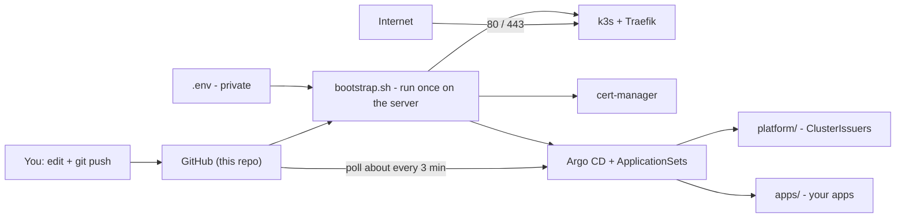

# HomeLab — k3s + Argo CD

Infrastructure-as-code for a single-node **k3s** cluster. **Argo CD** deploys everything under
`platform/` and `apps/` from this repository. Server IP, domain and other site-specific settings
live only in a private `.env`; nothing site-specific is committed.



## Quick start

```bash
# on your PC (once per clone)
sh tools/setup-git-hooks.sh          # secret scanning before every commit (needs gitleaks)
cp .env.example .env                 # fill in SERVER_IP (or leave empty), repo URL

# on a fresh Ubuntu 24.04 server
git clone https://github.com/<user>/<repo>.git /root/homelab
scp .env root@<server>:/root/homelab/            # from your PC
ssh root@<server> "cd /root/homelab && ./bootstrap.sh"
```

Then open `https://argocd.<BASE_DOMAIN>` and log in as `admin` (bootstrap prints how to get the
initial password). To deploy apps, add a folder under `apps/` and `git push`.

## What gets installed

| Component | Version | Installed by |
|---|---|---|
| k3s (secrets encryption on) + Traefik, CoreDNS, local-path, metrics-server | v1.36.5+k3s1 | `bootstrap.sh` |
| Helm | v3.22.1 | `bootstrap.sh` |
| cert-manager | v1.21.2 | `bootstrap.sh` (Helm) |
| Argo CD | v3.5.5 (chart `argo/argo-cd` 10.10.5) | `bootstrap.sh` (Helm) |
| ApplicationSets `platform`, `apps` | — | `bootstrap.sh` (from `argocd/`) |
| `platform/*`, `apps/*` | — | Argo CD, from Git |

Versions are pinned in [`versions.env`](versions.env).

## Documentation

| Doc | Read it when you want to… |
|---|---|
| [docs/architecture.md](docs/architecture.md) | understand the components, traffic flow, ports, namespaces and where state lives |
| [docs/bootstrap.md](docs/bootstrap.md) | know exactly what `bootstrap.sh` does, step by step |
| [docs/configuration.md](docs/configuration.md) | change settings: `.env`, `versions.env`, k3s config, Helm values, cluster values |
| [docs/gitops.md](docs/gitops.md) | understand the Argo CD setup, check deploy status, force or pause deploys |
| [docs/adding-an-app.md](docs/adding-an-app.md) | deploy something new |
| [docs/apps.md](docs/apps.md) | see what's deployed |
| [docs/tls-and-ingress.md](docs/tls-and-ingress.md) | debug certificates or hostnames |
| [docs/secret-scanning.md](docs/secret-scanning.md) | understand the gitleaks hook and what's not allowed in this public repo |
| [docs/operations.md](docs/operations.md) | upgrade, back up, restore, change IP, troubleshoot, harden |
| [docs/current-cluster.md](docs/current-cluster.md) | see the latest snapshot of the live cluster |
| [AGENTS.md](AGENTS.md) | read the rules for AI agents (and humans) changing this repo |

## Repository layout

```
bootstrap.sh              installs/converges the whole cluster (run as root on the server)
versions.env              pinned versions
.env.example              template for the private .env (git-ignored)
k3s/config.yaml           -> /etc/rancher/k3s/config.yaml
helm/cert-manager/        cert-manager values
helm/argo-cd/             Argo CD values (UI hostname comes from .env)
argocd/                   ApplicationSets: one Argo CD Application per platform/ and apps/ folder
platform/                 cluster-wide config deployed by Argo CD
apps/                     one Helm chart per app, deployed by Argo CD
tools/check.sh            repo self-check (run before every commit)
tools/export-cluster.sh   snapshot a live cluster
tools/setup-git-hooks.sh  enable the gitleaks pre-commit hook
.githooks/ .gitleaks.toml .github/workflows/   secret scanning
docs/                     documentation
.secrets/                 git-ignored: keys, exports
```
