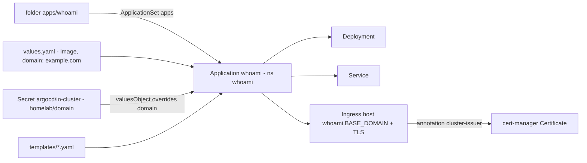

# Adding an app

Every app is a folder under `apps/` that Argo CD deploys as a Helm chart. The `apps` ApplicationSet
picks up new folders by itself: there is nothing to register.
`apps/whoami` is the reference example. Copy it and change the details.

## Anatomy of an app folder

```
apps/whoami/             # folder name = Application name = namespace = Helm release
├── Chart.yaml          # makes the folder a Helm chart (required)
├── values.yaml         # safe defaults (no real domain / IP / secrets)
└── templates/
    └── whoami.yaml     # Deployment + Service + Ingress, using {{ .Values.* }}
```



## Recipe: your own manifests

1. Copy the example:
   ```bash
   cp -r apps/whoami apps/myapp
   ```
2. `apps/myapp/Chart.yaml` — set `name: myapp`. The folder name becomes the namespace and the Helm release
   name, so keep it short, lowercase and unique.
3. `apps/myapp/values.yaml` — put app settings (image, replicas, ports). Keep `domain: example.com` as the placeholder.
4. `apps/myapp/templates/` — your Deployment/Service/Ingress. For hostnames always use
   ```yaml
   host: {{ .Values.host | default (printf "myapp.%s" .Values.domain) | quote }}
   ```
5. For the first deploy, use `cert-manager.io/cluster-issuer: letsencrypt-staging` on the Ingress. When it works, switch to `letsencrypt-prod`.
6. Commit and push. The pre-commit hook runs gitleaks first.
7. Watch the `myapp` tile in the Argo CD UI (or `kubectl -n argocd get application myapp`) until it is
   `Synced` / `Healthy`, then open `https://myapp.<BASE_DOMAIN>`.

## Recipe: a chart from a public Helm repo

Most charts can't build a hostname from `.Values.domain`. Wrap the upstream chart as a
dependency and own the Ingress yourself:

```yaml
# apps/myapp/Chart.yaml
apiVersion: v2
name: myapp
version: 0.1.0
dependencies:
  - name: upstream-chart          # chart name in the repo
    version: 1.2.3                # pin it
    repository: https://charts.example.org
```

```yaml
# apps/myapp/values.yaml
domain: example.com
upstream-chart:                   # values for the dependency go under its name
  ingress:
    enabled: false                # we template our own Ingress below
  persistence:
    enabled: true
    storageClass: local-path
```

```yaml
# apps/myapp/templates/ingress.yaml
apiVersion: networking.k8s.io/v1
kind: Ingress
metadata:
  name: myapp
  annotations:
    cert-manager.io/cluster-issuer: letsencrypt-prod
spec:
  ingressClassName: traefik
  tls:
    - hosts: [{{ printf "myapp.%s" .Values.domain | quote }}]
      secretName: myapp-tls
  rules:
    - host: {{ printf "myapp.%s" .Values.domain | quote }}
      http:
        paths:
          - path: /
            pathType: Prefix
            backend:
              service:
                name: {{ .Release.Name }}-upstream-chart   # check the real Service name with: helm template
                port: { number: 80 }
```

Argo CD's repo server runs `helm dependency build` for you when `charts/` is missing. Don't commit the generated `charts/` folder; committing `Chart.lock` is fine and pins the exact dependency.

## Storage

- Use `storageClassName: local-path` (the default). Data lives on the node under
  `/var/lib/rancher/k3s/storage/`. It is not replicated, and you have to back it up yourself (see [operations.md](operations.md#backups)).
- Deleting the app may leave the PVC/PV behind. That's intended, so your data survives.

## Secrets

The repo is public. **Never commit a `kind: Secret` with data.** gitleaks blocks it (rule `k8s-secret-data`).
Until Sealed Secrets or SOPS is added, create secrets by hand on the server:

```bash
kubectl create namespace myapp --dry-run=client -o yaml | kubectl apply -f -
kubectl -n myapp create secret generic myapp-secrets --from-literal=API_KEY='...'
```

and reference them from the chart (`envFrom.secretRef.name: myapp-secrets`). Write down in the
app's `values.yaml` (as a comment) which secrets must exist.

## Checklist before pushing

- [ ] Folder name = chart `name` (it is also the namespace and release name)
- [ ] Image tag pinned (no `latest`)
- [ ] `resources.requests` (and a memory limit) set. The node has 8 GB
- [ ] Hostname built from `.Values.domain`, no IPs or real domains in the files
- [ ] No secret values in any file
- [ ] `sh tools/check.sh` passes
- [ ] Docs updated (see `AGENTS.md`), e.g. list the app in `docs/apps.md`
