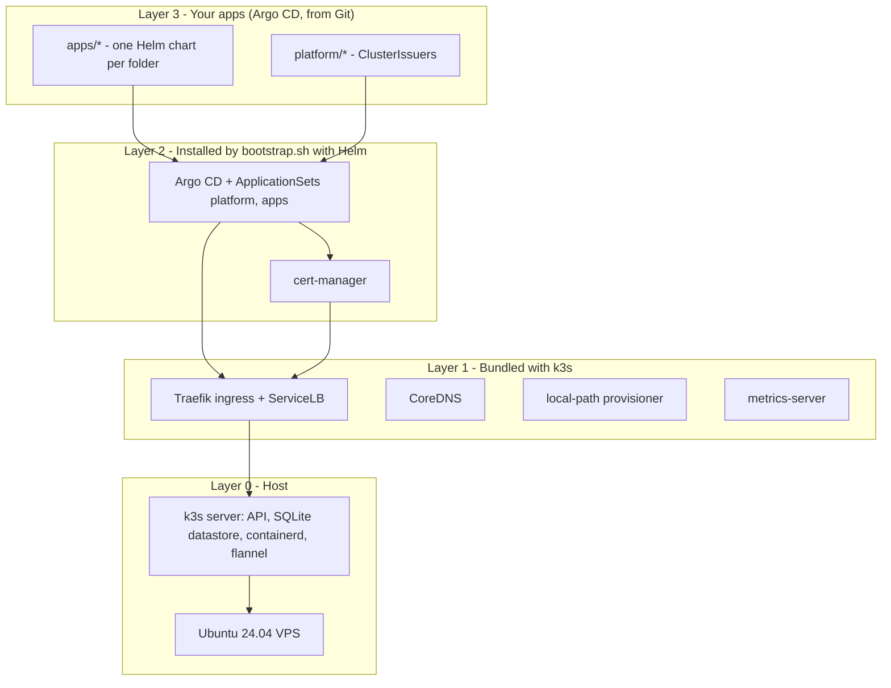
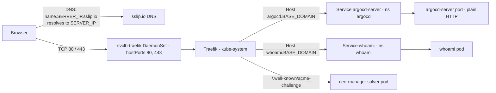

# Architecture

A single Ubuntu 24.04 VPS runs a one-node **k3s** cluster. On top of it run **cert-manager**
and **Argo CD**, and Argo CD deploys everything under `platform/` and `apps/` from this Git repository.

## Layers

| Layer | Who installs it | Source of truth in this repo |
|---|---|---|
| 0 Host | You / VPS provider | — |
| 0 k3s | `bootstrap.sh` (`get.k3s.io`) | `versions.env` (`K3S_VERSION`), `k3s/config.yaml` |
| 1 Traefik, CoreDNS, local-path, metrics-server | k3s auto-deploys from `/var/lib/rancher/k3s/server/manifests` | k3s defaults (not overridden) |
| 2 cert-manager | `bootstrap.sh` (`helm upgrade --install`) | `versions.env`, `helm/cert-manager/values.yaml` |
| 2 Argo CD | `bootstrap.sh` (`helm upgrade --install`) | `versions.env`, `helm/argo-cd/values.yaml`, `.env` (hostname) |
| 2 ApplicationSets + cluster values | `bootstrap.sh` (`kubectl apply`) | `argocd/*.yaml`, `.env` |
| 3 platform + apps | Argo CD, from Git | `platform/`, `apps/` |

Argo CD does not manage itself or cert-manager: both are converged by `bootstrap.sh`, so a broken
commit can never take down the tool that would deploy the fix.

## Request flow (HTTPS traffic)

- **DNS** — `sslip.io` is a public wildcard DNS: any name ending in `<ip>.sslip.io` resolves to `<ip>`.
  No DNS records to manage. Switch to your own domain by setting `BASE_DOMAIN` in `.env`
  and pointing a wildcard `A` record at the server.
- **Load balancer** — k3s ServiceLB (klipper-lb) runs `svclb-traefik-*` pods that bind host ports
  80 and 443 and forward to the Traefik Service of type `LoadBalancer`.
- **Ingress** — Traefik routes by `Host` header using standard Kubernetes `Ingress` objects
  (`ingressClassName: traefik`).
- **TLS** — terminated at Traefik with certificates issued by cert-manager from Let's Encrypt.
  `argocd-server` runs with `server.insecure: true` behind it. See [tls-and-ingress.md](tls-and-ingress.md).

## Network ports on the host

| Port | Protocol | Used by | Needs to be public? |
|---|---|---|---|
| 22 | TCP | SSH | yes (for you) — restrict by source IP if you can |
| 80 | TCP | Traefik HTTP + Let's Encrypt HTTP-01 challenges | **yes** |
| 443 | TCP | Traefik HTTPS (Argo CD UI, apps) | **yes** |
| 6443 | TCP | Kubernetes API (kubectl) | only for remote kubectl — restrict |
| 10250 | TCP | kubelet | no |
| 8472 | UDP | flannel VXLAN | only when adding nodes |

Argo CD pulls from GitHub, so no inbound port is needed for GitOps.
`ufw` is not configured by `bootstrap.sh` — see [operations.md](operations.md#hardening-todo).

## Namespaces

| Namespace | Contents |
|---|---|
| `kube-system` | k3s components, Traefik |
| `cert-manager` | cert-manager controller, webhook, cainjector |
| `argocd` | Argo CD (server, application controller, repo server, ApplicationSet controller, redis), ApplicationSets, Applications, **cluster Secret `in-cluster`** with the cluster values |
| `whoami`, … | one namespace per app (= folder name under `apps/`) |

## Where state lives

| State | Location | Rebuilt from Git? |
|---|---|---|
| Kubernetes objects | k3s SQLite DB `/var/lib/rancher/k3s/server/db/` | config yes, runtime state no |
| Secrets encryption key | `/var/lib/rancher/k3s/server/cred/encryption-config.json` | **no — back it up** |
| Cluster join token | `/var/lib/rancher/k3s/server/token` | no |
| Argo CD admin password, settings | Secrets / ConfigMaps in `argocd` | settings yes (`helm/argo-cd/values.yaml`), password no |
| PersistentVolume data | `/var/lib/rancher/k3s/storage/` (local-path) | no |
| Site-specific settings | `.env` on your PC / server (git-ignored) | no — keep a private copy |
