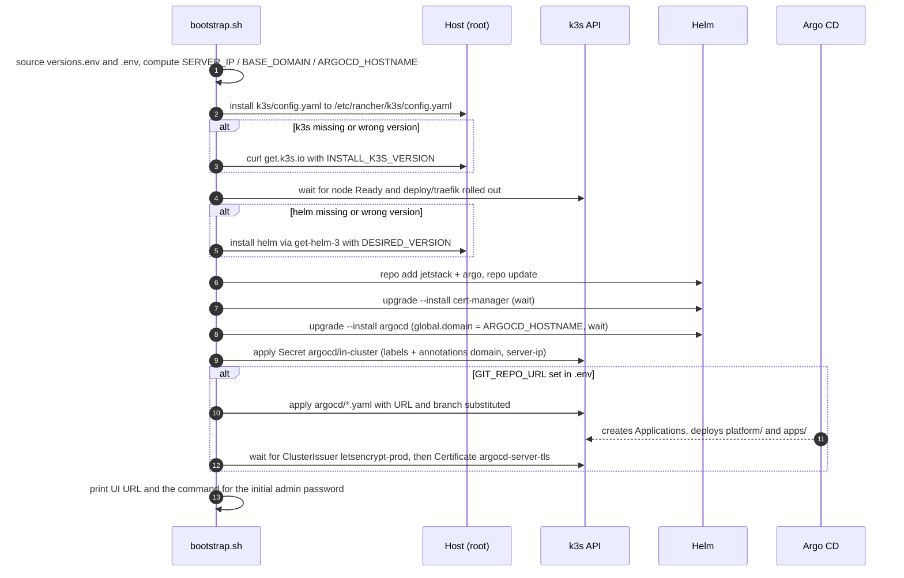

# bootstrap.sh — step by step

`bootstrap.sh` turns a fresh Ubuntu 24.04 server into the full cluster, and is safe to re-run on an
existing one (every step is "install if missing, otherwise converge to the pinned version").

## Prerequisites

- Ubuntu 24.04, root shell, outbound internet access
- Ports 80 and 443 reachable from the internet (Let's Encrypt HTTP-01)
- This repo checked out on the server, plus a filled-in `.env` copied next to `bootstrap.sh`
  (it is git-ignored, so `git clone` does not bring it — `scp` it)

```bash
git clone https://github.com/<user>/<repo>.git /root/homelab
# from your PC:  scp .env root@<server>:/root/homelab/
cd /root/homelab && ./bootstrap.sh
```

## Flow



## What each step does

| # | Step | Details | Idempotency |
|---|---|---|---|
| 1 | Load settings | `versions.env` (pinned versions, committed) then `.env` (site settings, private). `SERVER_IP` falls back to `api.ipify.org`, then the first local address. `BASE_DOMAIN` defaults to `SERVER_IP.sslip.io`; `ARGOCD_HOSTNAME` to `argocd.BASE_DOMAIN`; `GIT_BRANCH` to `main`. | pure computation |
| 2 | k3s config | Copies `k3s/config.yaml` → `/etc/rancher/k3s/config.yaml` (mode 0600). Enables `secrets-encryption`. | overwritten each run; k3s only re-reads it on restart |
| 3 | k3s install | Runs the official installer pinned to `K3S_VERSION`. Creates the `k3s` systemd unit and `/usr/local/bin/{k3s,kubectl,crictl,ctr}`. | skipped when `k3s --version` already matches |
| 4 | Wait | Until the node is `Ready` and Traefik (auto-deployed by k3s) has rolled out. | — |
| 5 | Helm | Installs Helm `HELM_VERSION`; adds repos `jetstack` and `argo`. | skipped when version matches; repo add uses `--force-update` |
| 6 | cert-manager | Release `cert-manager` in ns `cert-manager`, values `helm/cert-manager/values.yaml` (`crds.enabled: true`). `--wait` so its webhook is ready before anything requests certificates. | `helm upgrade --install` (no-op revision if nothing changed) |
| 7 | Argo CD | Release `argocd` in ns `argocd`, chart `argo/argo-cd` `ARGO_CD_CHART_VERSION`, values `helm/argo-cd/values.yaml` plus `global.domain` (the UI hostname) from `.env`. `--wait`. | `helm upgrade --install` |
| 8 | Cluster values | Secret `argocd/in-cluster`: registers the local cluster with Argo CD, labelled `homelab/cluster-values=true`, annotated with `homelab/domain` and `homelab/server-ip`. The `apps` ApplicationSet passes them to every app. See [configuration.md](configuration.md#cluster-values). | `kubectl apply` |
| 9 | GitOps seed | Only if `GIT_REPO_URL` is set and is not the `<user>` placeholder: `sed` fills `${GIT_REPO_URL}` and `${GIT_BRANCH}` in `argocd/*.yaml` and applies them. Argo CD then deploys `platform/` (ClusterIssuers) and `apps/`. | `kubectl apply` |
| 10 | TLS check | Waits up to 5 min for `ClusterIssuer letsencrypt-prod` and then for the Argo CD UI certificate. Prints a hint instead of failing if they are slow. | read-only |

## Typical runtimes

| Phase | Fresh server |
|---|---|
| k3s install + Traefik ready | 1–2 min |
| cert-manager | ~1 min |
| Argo CD | 1–3 min |
| First sync of platform/ and apps/ + Argo CD certificate | 1–3 min |

## Re-running

Re-run after changing `.env`, `versions.env`, `argocd/*.yaml` or anything under `k3s/` or `helm/`.
Changes under `platform/` or `apps/` do **not** need it — just `git push` (see [gitops.md](gitops.md)).

## First login

User `admin`. The initial password is generated by Argo CD; on the server:

```bash
kubectl -n argocd get secret argocd-initial-admin-secret -o jsonpath='{.data.password}' | base64 -d; echo
```

Change it in the UI (**User Info → Update Password**), then delete the generated one with
`kubectl -n argocd delete secret argocd-initial-admin-secret`. Re-running `bootstrap.sh` does not reset the password.
