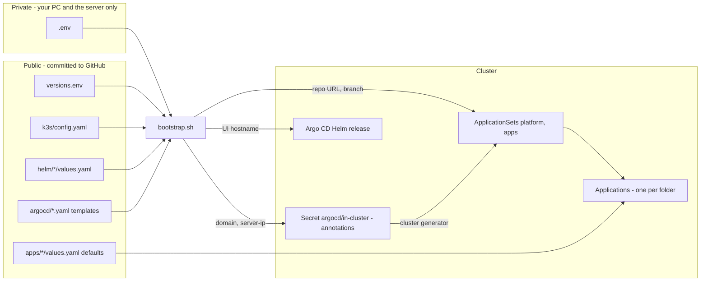

# Configuration

Configuration is split by **who may see it**: committed files are public on GitHub,
everything site-specific lives in `.env` (git-ignored) and in the cluster.



## `.env` (private, git-ignored)

Template: `.env.example`. Copy it to `.env` on your PC and on the server.

| Variable | Default when empty | Used for |
|---|---|---|
| `SERVER_IP` | auto-detected (`api.ipify.org`) | building `BASE_DOMAIN`; passed to apps as `serverIP` |
| `BASE_DOMAIN` | `SERVER_IP.sslip.io` | every hostname; passed to apps as `domain` |
| `ARGOCD_HOSTNAME` | `argocd.BASE_DOMAIN` | Argo CD UI hostname and its TLS certificate |
| `GIT_REPO_URL` | placeholder → GitOps step skipped | repo Argo CD deploys from (public HTTPS URL) |
| `GIT_BRANCH` | `main` | branch Argo CD follows |

There is no Let's Encrypt email: the ACME account is registered without one (it would be public in
`platform/cluster-issuer`), so you get no expiry warning mails. Renewal is automatic.

## `versions.env` (public)

Every component version is pinned here; `bootstrap.sh` converges to these.

| Variable | Component |
|---|---|
| `K3S_VERSION` | k3s (also decides the bundled Traefik, CoreDNS, etc.) |
| `HELM_VERSION` | Helm CLI on the server |
| `CERT_MANAGER_VERSION` | jetstack/cert-manager chart |
| `ARGO_CD_CHART_VERSION` | argo/argo-cd chart (decides the Argo CD version; see the chart's `appVersion`) |

Check compatibility before bumping: the Argo CD docs list the Kubernetes versions each Argo CD minor
is tested against, and the argo-cd chart declares a minimum `kubeVersion`.

## `k3s/config.yaml` (public)

Copied to `/etc/rancher/k3s/config.yaml`. Same keys as `k3s server --help` flags without the dashes.

| Key | Value | Why |
|---|---|---|
| `secrets-encryption` | `true` | Secrets are encrypted at rest in the datastore |
| `write-kubeconfig-mode` | `"0600"` | `/etc/rancher/k3s/k3s.yaml` readable by root only |

## Helm values (public)

| File | Release | Notes |
|---|---|---|
| `helm/cert-manager/values.yaml` | `cert-manager/cert-manager` | `crds.enabled: true` — the chart installs/upgrades its CRDs |
| `helm/argo-cd/values.yaml` | `argocd/argocd` | `server.insecure` (TLS ends at Traefik), Ingress with class `traefik` and `cert-manager.io/cluster-issuer: letsencrypt-prod`, dex and notifications disabled, resource requests/limits for every component. `global.domain` comes from `.env` with `--set`. |

## ApplicationSets (public templates)

`argocd/platform.yaml` and `argocd/apps.yaml` contain `${GIT_REPO_URL}` / `${GIT_BRANCH}`
placeholders that `bootstrap.sh` fills in. How they map folders to Applications is described in
[gitops.md](gitops.md#how-a-folder-becomes-an-application).

## Cluster values

`bootstrap.sh` writes this Secret (shown decoded; nothing secret is in it, it is a Secret because
that is how Argo CD stores clusters):

```yaml
apiVersion: v1
kind: Secret
metadata:
  name: in-cluster
  namespace: argocd
  labels:
    argocd.argoproj.io/secret-type: cluster    # Argo CD: this is a cluster definition
    homelab/cluster-values: "true"             # selected by the apps ApplicationSet
  annotations:
    homelab/domain: <BASE_DOMAIN>
    homelab/server-ip: <SERVER_IP>
# data: name=in-cluster, server=https://kubernetes.default.svc, config={"tlsClientConfig":{"insecure":false}}
```

The `apps` ApplicationSet uses a cluster generator on that label and hands the annotations to every app:

```yaml
helm:
  valuesObject:
    domain: '{{index .metadata.annotations "homelab/domain"}}'
    serverIP: '{{index .metadata.annotations "homelab/server-ip"}}'
```

The chart's own `values.yaml` holds harmless defaults (`domain: example.com`); `valuesObject`
overrides them at deploy time. So a template can use `{{ .Values.domain }}` and the real domain never touches Git.

> Rule of thumb: keep cluster-specific keys only in the cluster Secret and app-specific keys only in
> the chart's `values.yaml`, so the two never overlap.

Changing the annotations (by re-running `bootstrap.sh`) updates every generated Application
automatically, and Argo CD re-syncs them.

**To add a new cluster-wide value:**

1. Add the variable to `.env.example` and `.env`.
2. Add an annotation for it in the "cluster values" step of `bootstrap.sh`.
3. Add a matching line under `valuesObject` in `argocd/apps.yaml`.
4. Re-run `bootstrap.sh`, then document the value here and in [adding-an-app.md](adding-an-app.md).
