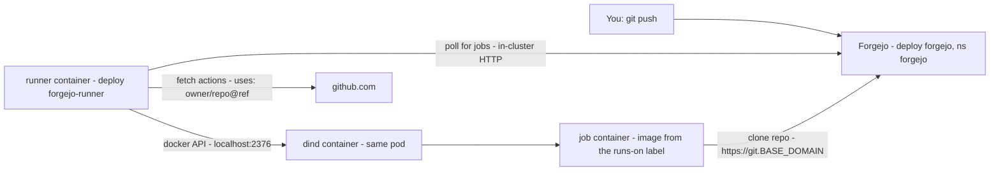
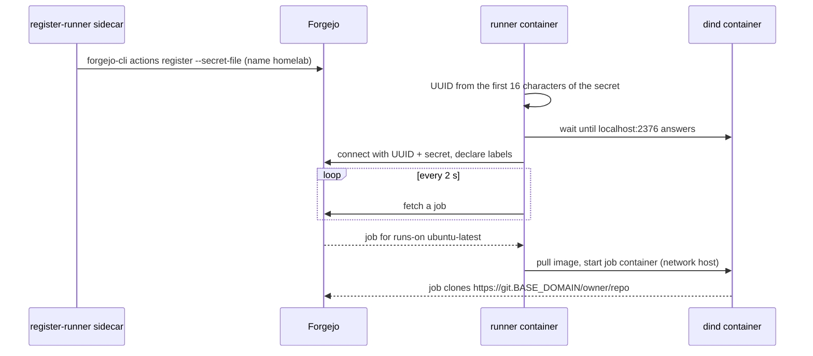

# Forgejo and Forgejo Actions

`apps/forgejo` runs **Forgejo** (Git server) at `https://git.<BASE_DOMAIN>` with **Forgejo Actions** enabled, and one
**Forgejo Runner** that runs the jobs in containers through Docker-in-Docker. Workflows are written like GitHub Actions
workflows, and `uses: actions/checkout@v4` is fetched from GitHub, so most GitHub workflows run with small changes
(see [Differences from GitHub Actions](#differences-from-github-actions)).



| Part | Where | What it does |
|---|---|---|
| Forgejo | `apps/forgejo` (wrapper of chart `forgejo-helm/forgejo`), Deployment `forgejo` | Web UI, API, Git over HTTPS, Actions. SQLite DB and repositories on PVC `forgejo-data` (10 Gi) |
| `register-runner` sidecar | container in the `forgejo` pod | Registers runner `homelab` with the shared secret on every start and when the mounted Secret changes (`forgejo forgejo-cli actions register`, idempotent) |
| Forgejo Runner | Deployment `forgejo-runner`: containers `runner` + `dind` (`templates/runner.yaml`) | Polls Forgejo, starts each job in a container on the Docker-in-Docker daemon |
| Secrets | Vault `kv/apps/forgejo/admin`, `kv/apps/forgejo/runner` → Secrets `forgejo-admin`, `forgejo-runner-token` | First admin account, shared runner secret ([secrets.md](secrets.md)) |
| Settings | `apps/forgejo/values.yaml` | Forgejo `app.ini` values (`forgejo.gitea.config`), runner labels and images (`runner`) |

## First-time setup

1. **Write the two secrets to Vault.** On the server (root), in the Vault pod (`=-` reads the value from stdin, so it
   stays out of history; the runner secret is generated in the pod and never shown):
   ```bash
   kubectl -n vault exec -it vault-0 -c vault -- sh
   vault login                                    # paste your token
   vault kv put kv/apps/forgejo/admin username=forgejo-admin password=-   # paste a password, then Ctrl-D
   head -c 20 /dev/urandom | od -An -tx1 | tr -d ' \n' | vault kv put kv/apps/forgejo/runner token=-
   rm ~/.vault-token && exit
   ```
   | Vault path | Keys | Notes |
   |---|---|---|
   | `kv/apps/forgejo/admin` | `username`, `password` | First admin account. Not `admin` (a reserved name in Forgejo). Every Forgejo start sets the password to this value (chart setting `passwordMode` is `keepUpdated`); put the password in your password manager |
   | `kv/apps/forgejo/runner` | `token` | Exactly 40 lowercase hex characters. Forgejo and the runner both read it ([offline registration](https://forgejo.org/docs/latest/admin/actions/registration/#offline-registration)) |
2. **Let Argo CD deploy it** (the folder is in Git). Until both secrets exist, the pods wait in
   `CreateContainerConfigError` / `ContainerCreating` and start on their own afterwards. Check (server, root):
   ```bash
   kubectl -n forgejo get externalsecret                        # both SecretSynced, READY True
   kubectl -n forgejo get pods                                  # forgejo 2/2, forgejo-runner 2/2
   kubectl -n forgejo logs deploy/forgejo -c register-runner    # "runner homelab registered"
   kubectl -n forgejo logs deploy/forgejo-runner -c runner      # "... declared successfully"
   ```
3. **Sign in** at `https://git.<BASE_DOMAIN>` with the admin account. Change its e-mail address under
   **Settings → Account** (the chart sets the placeholder `gitea@local.domain`). **Site administration → Actions →
   Runners** shows `homelab` as online with the labels below. Self-registration is off: create accounts under
   **Site administration → User accounts**.

Clone and push over HTTPS (`https://git.<BASE_DOMAIN>/<owner>/<repo>.git`, password or an access token). SSH is
disabled: port 22 on the host is the server's own SSH.

## Writing workflows

Forgejo reads workflows (`*.yaml`, `*.yml`) from `.forgejo/workflows/`. If a repository has no `.forgejo/workflows` folder,
it reads `.github/workflows` instead, so a repository moved from GitHub (**+ → New migration → GitHub**) keeps its
workflows.

`runs-on` picks the image the job runs in (set in `runner.labels` in `apps/forgejo/values.yaml`):

| `runs-on` | Job image | Use for |
|---|---|---|
| `docker` | `node:24.22.0-bookworm` (Debian, Node.js, git) | small jobs; the Forgejo default environment |
| `ubuntu-latest`, `ubuntu-24.04` | `ghcr.io/catthehacker/ubuntu:act-24.04-20260815` | workflows written for GitHub: Ubuntu with many of the tools GitHub's runners have, including the `docker` CLI. Large image: the first job after a runner restart spends a minute or more pulling it |

`uses: owner/repo@ref` without a host is fetched from `https://github.com` (`DEFAULT_ACTIONS_URL`), as on GitHub.
A full URL picks another host, e.g. `uses: https://code.forgejo.org/actions/checkout@v4`.

```yaml
# .forgejo/workflows/build.yaml (or .github/workflows/build.yaml)
on:
  push:
    branches: [main]
  pull_request:
jobs:
  build:
    runs-on: ubuntu-latest
    steps:
      - uses: actions/checkout@v4
      - uses: actions/setup-node@v4
        with:
          node-version: 24
      - run: npm ci && npm test
      - run: docker build -t myapp:${{ github.sha }} .   # the Docker-in-Docker daemon of the runner pod
```

Every job can use Docker: `DOCKER_HOST`, `DOCKER_TLS_VERIFY` and `DOCKER_CERT_PATH` point at the `dind` container,
so `docker build`, `docker run` and Docker-based actions work. Images pulled or built there are cached until the
runner pod restarts.

Secrets for workflows: **Repository → Settings → Actions → Secrets**, used as `${{ secrets.NAME }}`. Reading build
secrets from Vault with an OIDC token is planned, see [secrets.md](secrets.md#builds-forgejo-actions).

### Differences from GitHub Actions

Forgejo Actions aims to be *familiar*, not *compatible*
([Forgejo docs](https://forgejo.org/docs/latest/user/actions/github-actions/)). Known differences:

- The default environment is different. `runs-on: docker` is a Debian image with Node.js; `ubuntu-*` here is a
  community image (`catthehacker/ubuntu`) that is close to, but not the same as, GitHub's runner image.
- Some keys of the `github` context are missing.
- Some job keys are ignored, e.g. `permissions` and `continue-on-error`.
- OIDC ID tokens are enabled with `enable-openid-connect: true` in the workflow, not `permissions: id-token: write`.
- Actions that call the GitHub REST or GraphQL API (create a release, comment on a pull request, the `gh` CLI)
  generally don't work: Forgejo's API is different. Look for a Forgejo equivalent under `https://code.forgejo.org/actions`.

## How the runner is wired



- **Registration** needs no clicks in the UI. Both sides read the same 40-character secret from Secret
  `forgejo-runner-token`: Forgejo stores it for runner `homelab` (the UUID is the first 16 characters as bytes,
  the whole secret is the token), and the runner computes the same UUID at start and reads the token from the
  mounted file `/run/runner/token` (`token_url` in its config). Nothing secret is in the runner's ConfigMap.
- **The runner reaches Forgejo inside the cluster** (`http://forgejo-http.forgejo.svc:3000/`). **Jobs** get
  `https://git.<BASE_DOMAIN>` (Forgejo's `ROOT_URL`) and clone from there, so the server must reach its own public
  hostname (see [troubleshooting](#troubleshooting)).
- **Jobs share the pod's network** (`container.network: host`): they reach the Docker daemon on `localhost:2376`, the
  runner's cache server (`actions/cache`), and cluster DNS names like any pod.
- **One job at a time** (`runner.capacity: 1`). `dind` has a 3 Gi memory limit that covers all job containers, and
  its image cache is an `emptyDir` of at most `runner.dockerStorage` (20 Gi). Past that the pod is evicted and starts
  again with an empty cache.
- Runner pods are replaced on every change to the runner config (checksum annotation). Running jobs are cancelled.

To add a label (another job image), add a `name:docker://image:tag` line to `runner.labels` and push.

## Security

- **Every workflow that runs is root on the server.** `dind` is a privileged container, and every job gets its
  Docker client certificates. A job's own container is not privileged, but through the Docker API any step can
  start a privileged container, and from there take over the node: the k3s datastore and its encryption key,
  the Vault data and unseal key, and the volumes of every other app. `runner.capacity: 1` limits how many jobs run,
  not what they can do. The cluster has no containment for this; the only control is who and what gets to run.
- **Code that runs:** the workflow files, everything they execute (build scripts, package installs), every
  `uses:` action and its dependencies, and the job images. Treat all of it as root on the server:
  - Keep registration closed (`DISABLE_REGISTRATION`) and give write access only to people you would give root.
  - Pull requests from forks and from AGit need a maintainer's approval before their workflows run
    ([Forgejo docs](https://forgejo.org/docs/latest/user/actions/security-pull-request/)). Read the workflow
    and the changed files before you approve, and don't choose **Approve always** for anyone you wouldn't give root.
  - Pin third-party actions to a full commit SHA (`uses: owner/action@<40-character SHA>`), not a tag that its owner
    can move, and keep the list of actions short.
  - Don't mirror or migrate untrusted repositories with Actions enabled (turn Actions off in the repository's settings).
- **Containment would need another machine.** Moving the runner to a separate VM without cluster credentials or
  app data is the fix ([operations.md](operations.md#hardening-todo)); this repo doesn't do that yet.
- Jobs can reach every Service in the cluster (Vault included), like any pod. Vault still needs a token.
- Forgejo is on the internet at `https://git.<BASE_DOMAIN>`, reachable from the IPs the provider firewall allows
  (see [architecture.md](architecture.md#network-ports-on-the-host)).

### Rotating the runner secret

Write a new value to `kv/apps/forgejo/runner` that keeps the **first 16 characters** and changes the last 24 (the
first 16 identify the runner). Running the registration again with the same first 16 characters updates the secret
of the existing runner ([Forgejo docs](https://forgejo.org/docs/latest/admin/actions/registration/#offline-registration)).
Then, on the server (root), one step at a time:

```bash
# 1. fingerprint of the current Secret and count of registrations so far (no secret is printed)
before=$(kubectl -n forgejo get secret forgejo-runner-token -o jsonpath='{.data.token}' | sha256sum)
n=$(kubectl -n forgejo logs deploy/forgejo -c register-runner | grep -c 'runner homelab registered')
# 2. re-read Vault now, and wait until the Secret holds the new value
kubectl -n forgejo annotate externalsecret forgejo-runner-token force-sync=$(date +%s) --overwrite
until [ "$(kubectl -n forgejo get secret forgejo-runner-token -o jsonpath='{.data.token}' | sha256sum)" != "$before" ]; do sleep 5; done
# 3. wait until register-runner has registered the new value (the kubelet updates the mounted file within ~2 minutes)
until [ "$(kubectl -n forgejo logs deploy/forgejo -c register-runner | grep -c 'runner homelab registered')" -gt "$n" ]; do sleep 10; done
# 4. only now restart the runner, so it reads the new value, and wait until it has connected
kubectl -n forgejo rollout restart deploy/forgejo-runner
kubectl -n forgejo rollout status deploy/forgejo-runner
until kubectl -n forgejo logs deploy/forgejo-runner -c runner | grep -q 'declared successfully'; do sleep 5; done
```

Steps 2 and 3 wait without a time limit. If one takes more than 5 minutes, press Ctrl-C:
`kubectl -n forgejo get externalsecret forgejo-runner-token` shows why the sync fails (step 2), and
`kubectl -n forgejo logs deploy/forgejo -c register-runner` why the registration fails (step 3).
**Recovering from an interrupted rotation:** whatever the order so far, both sides read the current Secret on start.
Restart `deploy/forgejo`, wait for `runner homelab registered` in its `register-runner` log, then restart
`deploy/forgejo-runner`. Finally, **Site administration → Actions → Runners** must show `homelab` online once.

A value with **new** first 16 characters registers a second runner; delete the old, offline one in **Site
administration → Actions → Runners**.

If Vault is changed without these steps, the Secret is refreshed within an hour and `register-runner` registers the new
value on its own. The running runner still uses the old value, so expect it to fail with `unauthenticated` until
`deploy/forgejo-runner` is restarted.

## Backup and upgrade

All Forgejo data (repositories, SQLite DB, attachments, Actions logs) is on PVC `forgejo-data`. It has
`argocd.argoproj.io/sync-options: Delete=false`, so deleting the Application keeps it. Back it up like other app data
([operations.md](operations.md#backups)), with Forgejo stopped for the whole `tar`. Argo CD self-heal would scale
the Deployment back to 1 within seconds, so stop the Argo CD application controller first
([pausing GitOps](gitops.md#pausing-gitops)). On the server (root):

```bash
kubectl -n argocd scale statefulset argocd-application-controller --replicas=0
kubectl -n forgejo scale deploy/forgejo --replicas=0
kubectl -n forgejo wait --for=delete pod -l app.kubernetes.io/name=forgejo --timeout=120s
tar -czf /root/forgejo-$(date +%F).tgz -C /var/lib/rancher/k3s/storage "$(kubectl -n forgejo get pvc forgejo-data -o jsonpath='{.spec.volumeName}')_forgejo_forgejo-data"
kubectl -n forgejo scale deploy/forgejo --replicas=1
kubectl -n argocd scale statefulset argocd-application-controller --replicas=1
```

Run the last two lines even if `tar` fails: while the controller is stopped, Argo CD deploys nothing.

Upgrades: bump the dependency `version` in `apps/forgejo/Chart.yaml`, `forgejo.image.tag` **and** the
`register-runner` image in `apps/forgejo/values.yaml` (`tools/check.sh` compares them), push. Read the Forgejo
release notes and the chart's changelog first and take a backup: Forgejo migrates the DB on start and can't be
downgraded. The runner and `dind` images are in `runner.image` / `runner.dindImage`.

## Troubleshooting

| Symptom | Check |
|---|---|
| Pods stay in `CreateContainerConfigError` / `ContainerCreating` | the Secrets don't exist yet: `kubectl -n forgejo get externalsecret`, then [first-time setup](#first-time-setup) step 1 |
| `runner: Secret forgejo-runner-token ... must be 40 lowercase hex characters` | fix the value in Vault (`kv/apps/forgejo/runner`, key `token`), then follow [rotating the runner secret](#rotating-the-runner-secret) |
| Runner logs `unauthenticated` / runner offline in the UI | `kubectl -n forgejo logs deploy/forgejo -c register-runner`. After changing the secret, follow [rotating the runner secret](#rotating-the-runner-secret) (the recovery paragraph if in doubt) |
| Job waits for a runner forever | its `runs-on` matches no label in `runner.labels`, or the runner is busy (`capacity: 1`) |
| `actions/checkout` can't connect to `git.BASE_DOMAIN` | jobs clone through the public hostname. If the server's public IP is not on its network interface (NAT), traffic goes out to the provider firewall; allow the server's own IP there |
| `uses:` fails to clone `https://github.com/...` | wrong action name or tag, or no outbound internet from the pod |
| `forgejo-runner` pod `Evicted` | the `dind` cache grew past `runner.dockerStorage`; raise it or use smaller job images |
| `docker: Cannot connect to the Docker daemon` in a job | `kubectl -n forgejo logs deploy/forgejo-runner -c dind` |
| UI shows `http://git.example.com` links or a wrong domain | ConfigMap `forgejo-server` is read at pod start: `kubectl -n forgejo rollout restart deploy/forgejo` |
| No certificate / 404 | see [tls-and-ingress.md](tls-and-ingress.md#debugging-a-certificate) (Ingress `forgejo`, Secret `forgejo-tls`) |
