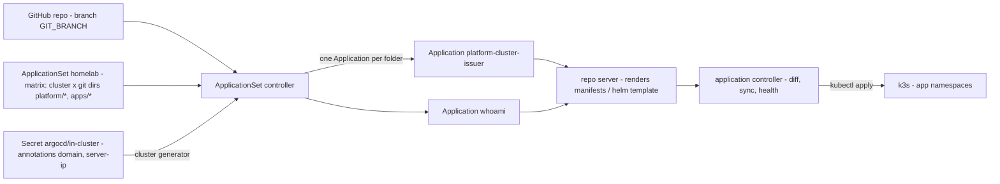
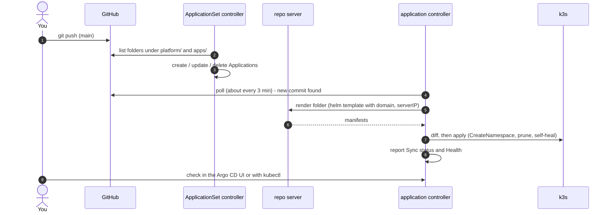

# GitOps with Argo CD

After bootstrap, **`git push` is the deploy.** `bootstrap.sh` installs Argo CD and applies the
ApplicationSet `homelab` from `argocd/homelab.yaml`. It turns every folder under `platform/` and `apps/` into an
Argo CD `Application` that syncs automatically.

## Objects and controllers



| Object | Namespace | What it is |
|---|---|---|
| `ApplicationSet homelab` | `argocd` | From `argocd/homelab.yaml`. Matrix of the cluster generator (clusters labelled `homelab/cluster-values=true`) and the git directory generator over `platform/*` and `apps/*`. Creates one `Application` per folder, a Helm chart with `domain` / `serverIP` passed as values. |
| `Secret in-cluster` | `argocd` | Written by `bootstrap.sh`. Registers the local cluster with Argo CD and carries the private cluster values as annotations. See [configuration.md](configuration.md#cluster-values). |
| `Application` | `argocd` | One per folder. Source = this repo at `GIT_BRANCH`, path = the folder. Destination namespace = folder name. |

The ApplicationSet is applied by `bootstrap.sh` with `${GIT_REPO_URL}` / `${GIT_BRANCH}` filled
in from `.env`, so the repo URL stays out of Git. Changing `argocd/*.yaml` therefore needs a re-run of
`./bootstrap.sh` on the server (a `git push` alone does not update it).

## Deploy flow



## How a folder becomes an Application

| Folder | Application name | Namespace | Rendered as | Values |
|---|---|---|---|---|
| `platform/<name>/` | `platform-<name>` | `<name>` (created automatically) | Helm chart (required), release name `<name>` | chart `values.yaml` + `domain`, `serverIP` from the cluster |
| `apps/<name>/` | `<name>` | `<name>` (created automatically) | Helm chart (required), release name `<name>` | chart `values.yaml` + `domain`, `serverIP` from the cluster |

The `platform-` prefix comes from the template's `name`; everything else is the same for both kinds of folder except
[deletion](#deleting-applications).

Sync policy: **automated** with `prune: true` (objects removed from Git are deleted) and
`selfHeal: true` (manual `kubectl edit`s are reverted), plus `CreateNamespace=true`. A failed sync is retried 10 times
(10 s, doubling up to 3 min: about 20 minutes in all). After the last retry Argo CD does not auto-sync that commit again
(`Skipping auto-sync: failed previous sync attempt`) until the next push or a manual **Sync**.

Nothing orders the Applications against each other. On a new cluster an app with an `ExternalSecret` can sync before
`platform-external-secrets` has installed its CRDs and its webhook is ready; that sync fails and is retried until
the operator is up, which the 20 minutes of retries cover.
Resources that need server-side apply opt in with the annotation `argocd.argoproj.io/sync-options: ServerSideApply=true`
(the External Secrets CRDs, which don't fit the client-side apply annotation, via `crds.annotations` in
`platform/external-secrets/values.yaml`). A platform chart with only cluster-scoped objects (`cluster-issuer`) still gets
an empty namespace of its name; that is harmless.

Within one Application, `argocd.argoproj.io/sync-wave` orders resources: e.g. `ClusterSecretStore vault` is
wave `1`, so it is applied only after the External Secrets operator and its webhook (wave `0`) are healthy.
Wrapper charts (`platform/vault`, `platform/external-secrets`, `apps/forgejo`) declare the upstream chart in `Chart.yaml`
(from a Helm repository, or a public OCI registry such as `oci://code.forgejo.org/forgejo-helm`, which needs no credentials);
`charts/` and `Chart.lock` are not committed, so the repo server downloads it (`helm dependency build`) whenever it
renders a commit it has no cached manifests for. If the chart repository is unreachable then, the Application shows
`ComparisonError` until it is reachable again. Resources that are already running are not affected.

Folder names must be unique across `platform/` and `apps/`, and valid Kubernetes names
(lowercase letters, digits, `-`).

## Deleting Applications

When the **ApplicationSet controller** deletes an Application (its folder was removed, or the cluster Secret is gone),
what happens to the resources depends on the folder:

| Folder | Application finalizer | Resources | Why |
|---|---|---|---|
| `apps/*` | `resources-finalizer.argocd.argoproj.io` (added by `templatePatch`) | deleted with the Application | removing a folder cleanly removes the app |
| `platform/*` | none | keep running | shared components must survive their Application: cascading would remove Vault, the ClusterIssuers and the External Secrets CRDs (and with the CRDs every `ExternalSecret` in the cluster and the Secrets they own) |

`syncPolicy.preserveResourcesOnDeletion: true` on the ApplicationSet is what keeps `platform/*` Applications free of
the finalizer: without it the controller adds `resources-finalizer` to every Application whose template has none.

**Deleting by hand cascades, platform included.** A delete from the Argo CD UI (propagation *Foreground* or
*Background*) or `argocd app delete` (default `--cascade=true`) adds the finalizer at delete time and removes
everything the Application deployed. For a `platform-*` Application that takes down Vault or the External Secrets
CRDs as described above. Delete platform Applications only non-cascading: in the UI choose **Non-cascading**, or
`argocd app delete platform-<name> --cascade=false`, or on the server (root):

```bash
kubectl -n argocd delete application platform-<name>   # no finalizer on platform Applications: resources stay
```

The ApplicationSet recreates the Application on its next reconcile as long as the folder exists. The same applies to
the ApplicationSet itself: removing it by hand needs `kubectl -n argocd delete applicationset homelab --cascade=orphan`,
otherwise its Applications are deleted and the apps' finalizers delete their resources.

**If `Secret argocd/in-cluster` is deleted or relabelled**, the cluster generator returns nothing and every
Application is deleted. The platform components keep running. The apps do **not**: their
finalizer deletes everything their charts deploy, including their `ExternalSecret`s, the Secrets those own, and
PersistentVolumeClaims defined in the chart (local-path then deletes the data). Re-running `./bootstrap.sh`
recreates the Secret; the apps then come back and their Secrets are re-synced from Vault, but deleted volume data
is gone. Don't edit that Secret by hand; keep [backups](operations.md#backups) of app data.

## Checking status

UI: `https://argocd.<BASE_DOMAIN>` (user `admin`). Each tile is an Application; open it for the
resource tree, live diff, events and logs.

On the server:

```bash
kubectl -n argocd get applicationsets                     # homelab
kubectl -n argocd get applications                        # SYNC STATUS + HEALTH per folder
kubectl -n argocd describe application whoami             # conditions and last sync result
kubectl -n argocd describe applicationset homelab         # generator errors (e.g. no cluster matched)
kubectl -n argocd logs deploy/argocd-applicationset-controller
kubectl -n argocd logs deploy/argocd-repo-server          # clone / helm template problems
kubectl -n argocd logs statefulset/argocd-application-controller   # apply problems
```

| Sync status | Meaning |
|---|---|
| `Synced` | Live objects match Git |
| `OutOfSync` | Git and cluster differ: a sync is pending, failed, or something was changed by hand |
| `Unknown` | Argo CD could not render the folder — see the Application's conditions |

| Health | Meaning |
|---|---|
| `Healthy` | All resources are ready |
| `Progressing` | Pods starting, certificate pending, … |
| `Degraded` | Something failed (crash loop, failed rollout) |
| `Missing` | Resource expected from Git does not exist yet |

The Argo CD CLI is optional. If you install it, log in through the ingress with
`argocd login argocd.<BASE_DOMAIN> --grpc-web`.

## Forcing a redeploy

- Refresh (re-read Git now instead of waiting for the poll): UI → app → **Refresh**, or
  ```bash
  kubectl -n argocd annotate application whoami argocd.argoproj.io/refresh=normal --overwrite
  ```
- Sync now / retry after an error: UI → app → **Sync**.
- After changing cluster values (re-running `bootstrap.sh`), the ApplicationSet updates the
  Applications by itself and they re-sync.

For instant deploys instead of polling, a GitHub webhook to `https://argocd.<BASE_DOMAIN>/api/webhook`
can be added later (not configured).

## Removing things

Delete the folder and push. The ApplicationSet deletes the Application (see [Deleting Applications](#deleting-applications)).

- `apps/<name>`: the finalizer also deletes its resources. The namespace and any PersistentVolumes created by
  local-path may remain — clean those up by hand if wanted.
- `platform/<name>`: the resources stay. Delete them by hand on the server (root): `kubectl delete namespace <name>`,
  plus any cluster-scoped objects the chart created (CRDs, ClusterIssuers, ClusterRoles, webhooks). Check what
  depends on the component first: deleting a CRD deletes all its custom resources.

## Pausing GitOps

Turn off automated sync for one app:

```bash
kubectl -n argocd patch application whoami --type merge -p '{"spec":{"syncPolicy":{"automated":null}}}'
```

The ApplicationSet puts the policy back on its next reconcile. To pause everything, stop the
controllers instead:

```bash
kubectl -n argocd scale statefulset argocd-application-controller --replicas=0
kubectl -n argocd scale deploy argocd-applicationset-controller --replicas=0
```

Scale them back to `1` to resume (or re-run `./bootstrap.sh`).

## Changing repo URL or branch

Edit `GIT_REPO_URL` / `GIT_BRANCH` in `.env` and re-run `./bootstrap.sh` (it re-applies the ApplicationSet).
