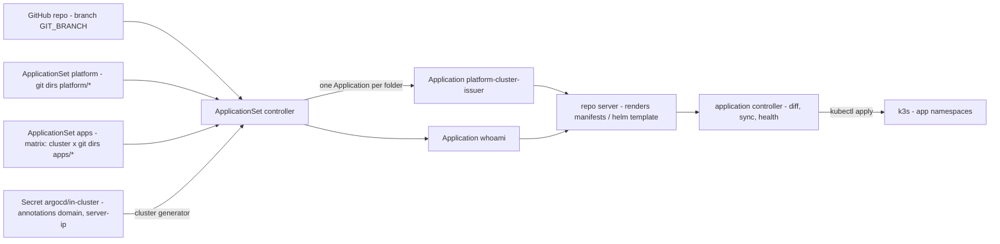
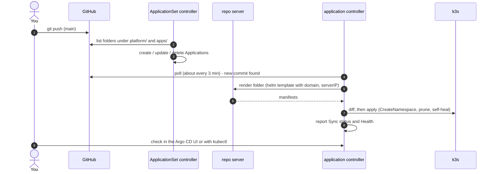

# GitOps with Argo CD

After bootstrap, **`git push` is the deploy.** `bootstrap.sh` installs Argo CD and applies two
ApplicationSets from `argocd/`. They turn every folder under `platform/` and `apps/` into an Argo CD
`Application` that syncs automatically.

## Objects and controllers



| Object | Namespace | What it is |
|---|---|---|
| `ApplicationSet platform` | `argocd` | From `argocd/platform.yaml`. Git directory generator over `platform/*`. Creates `Application platform-<folder>`. Folders may be plain manifests or a Helm chart (auto-detected); they get no cluster values. |
| `ApplicationSet apps` | `argocd` | From `argocd/apps.yaml`. Matrix of the cluster generator (clusters labelled `homelab/cluster-values=true`) and the git directory generator over `apps/*`. Creates `Application <folder>`, a Helm chart with `domain` / `serverIP` passed as values. |
| `Secret in-cluster` | `argocd` | Written by `bootstrap.sh`. Registers the local cluster with Argo CD and carries the private cluster values as annotations. See [configuration.md](configuration.md#cluster-values). |
| `Application` | `argocd` | One per folder. Source = this repo at `GIT_BRANCH`, path = the folder. Destination namespace = folder name. |

Both ApplicationSets are applied by `bootstrap.sh` with `${GIT_REPO_URL}` / `${GIT_BRANCH}` filled
in from `.env`, so the repo URL stays out of Git. Changing `argocd/*.yaml` therefore needs a re-run of
`./bootstrap.sh` on the server (a `git push` alone does not update them).

## Deploy flow



## How a folder becomes an Application

| Folder | Application name | Namespace | Rendered as | Values |
|---|---|---|---|---|
| `platform/<name>/` | `platform-<name>` | `<name>` (not created; for cluster-scoped objects it doesn't matter) | Helm chart if `Chart.yaml` exists, else plain `*.yaml` | none |
| `apps/<name>/` | `<name>` | `<name>` (created automatically) | Helm chart (required), release name `<name>` | chart `values.yaml` + `domain`, `serverIP` from the cluster |

Sync policy for both: **automated** with `prune: true` (objects removed from Git are deleted) and
`selfHeal: true` (manual `kubectl edit`s are reverted). Failed syncs retry 5 times with backoff.
Applications carry the `resources-finalizer.argocd.argoproj.io` finalizer, so deleting one also
deletes its resources.

Folder names must be unique across `platform/` and `apps/`, and valid Kubernetes names
(lowercase letters, digits, `-`).

## Checking status

UI: `https://argocd.<BASE_DOMAIN>` (user `admin`). Each tile is an Application; open it for the
resource tree, live diff, events and logs.

On the server:

```bash
kubectl -n argocd get applicationsets                     # platform, apps
kubectl -n argocd get applications                        # SYNC STATUS + HEALTH per folder
kubectl -n argocd describe application whoami             # conditions and last sync result
kubectl -n argocd describe applicationset apps            # generator errors (e.g. no cluster matched)
kubectl -n argocd logs deploy/argocd-applicationset-controller
kubectl -n argocd logs deploy/argocd-repo-server          # clone / helm template problems
kubectl -n argocd logs statefulset/argocd-application-controller   # apply problems
```

| Sync status | Meaning |
|---|---|
| `Synced` | Live objects match Git |
| `OutOfSync` | Git and cluster differ: a sync is pending, failed, or something was changed by hand |
| `Unknown` | Argo CD could not render the folder — see the Application's conditions |

| Health | Meaning |
|---|---|
| `Healthy` | All resources are ready |
| `Progressing` | Pods starting, certificate pending, … |
| `Degraded` | Something failed (crash loop, failed rollout) |
| `Missing` | Resource expected from Git does not exist yet |

The Argo CD CLI is optional. If you install it, log in through the ingress with
`argocd login argocd.<BASE_DOMAIN> --grpc-web`.

## Forcing a redeploy

- Refresh (re-read Git now instead of waiting for the poll): UI → app → **Refresh**, or
  ```bash
  kubectl -n argocd annotate application whoami argocd.argoproj.io/refresh=normal --overwrite
  ```
- Sync now / retry after an error: UI → app → **Sync**.
- After changing cluster values (re-running `bootstrap.sh`), the ApplicationSet updates the
  Applications by itself and they re-sync.

For instant deploys instead of polling, a GitHub webhook to `https://argocd.<BASE_DOMAIN>/api/webhook`
can be added later (not configured).

## Removing things

Delete the folder and push. The ApplicationSet deletes the Application, and the finalizer deletes its
resources. The namespace and any PersistentVolumes created by local-path may remain — clean those up by hand if wanted.

## Pausing GitOps

Turn off automated sync for one app:

```bash
kubectl -n argocd patch application whoami --type merge -p '{"spec":{"syncPolicy":{"automated":null}}}'
```

The ApplicationSet puts the policy back on its next reconcile. To pause everything, stop the
controllers instead:

```bash
kubectl -n argocd scale statefulset argocd-application-controller --replicas=0
kubectl -n argocd scale deploy argocd-applicationset-controller --replicas=0
```

Scale them back to `1` to resume (or re-run `./bootstrap.sh`).

## Changing repo URL or branch

Edit `GIT_REPO_URL` / `GIT_BRANCH` in `.env` and re-run `./bootstrap.sh` (it re-applies the ApplicationSets).
