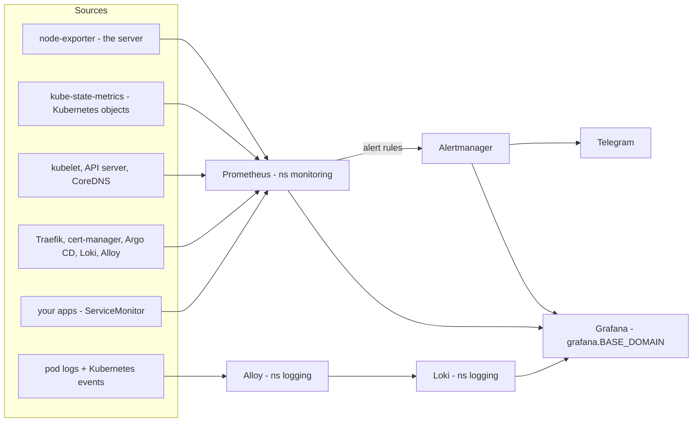

# Monitoring: metrics, logs, alerts

Everything is in **Grafana** at `https://grafana.<BASE_DOMAIN>`: the server, Kubernetes, the platform components
and your apps, with metrics and logs side by side. Alerts go to **Telegram**.

| Folder | What runs | Data |
|---|---|---|
| `platform/monitoring` (wrapper of `kube-prometheus-stack` + `prometheus-operator-crds`) | Prometheus Operator, Prometheus, Alertmanager, Grafana, node-exporter, kube-state-metrics | Prometheus: 10 days / at most 8 GB on a 10 Gi PV. Alertmanager 1 Gi PV, Grafana 1 Gi PV |
| `platform/logging` (wrapper of `loki` + `alloy`) | Loki (one pod), Grafana Alloy (DaemonSet) | Loki: 7 days on a 10 Gi PV |



Commands on this page run in bash **on the server as root** (`export KUBECONFIG=/etc/rancher/k3s/k3s.yaml`),
unless a block says otherwise.

## First-time setup

1. **Create a Telegram bot.** In Telegram, open a chat with `@BotFather`, send `/newbot` and follow the prompts.
   It replies with the bot token. Send any message to your new bot (or add it to a group and write something there).
2. **Find the chat ID.** Open `https://api.telegram.org/bot<TOKEN>/getUpdates` in a browser on your PC and take
   `result[].message.chat.id` (a number; group IDs start with `-`). Close the tab afterwards: the URL contains the token.
3. **Write both secrets to Vault** (UI: `kv` → **Create secret**, or the CLI in the pod as in
   [secrets.md](secrets.md#giving-an-app-a-secret)):

   | Vault path | Keys |
   |---|---|
   | `kv/apps/monitoring/grafana` | `admin-user` (e.g. `admin`), `admin-password` (e.g. from `openssl rand -base64 24`) |
   | `kv/apps/monitoring/alertmanager-telegram` | `bot-token`, `chat-id` |

   ```bash
   kubectl -n vault exec -it vault-0 -c vault -- sh
   vault login                                                     # paste your token
   vault kv put kv/apps/monitoring/grafana admin-user=admin admin-password=-   # paste the password, Ctrl-D
   vault kv put kv/apps/monitoring/alertmanager-telegram chat-id=<CHAT_ID> bot-token=-   # paste the token, Ctrl-D
   rm ~/.vault-token && exit
   ```
4. **Push** the repo. Argo CD creates `platform-monitoring` and `platform-logging`. Grafana and Alertmanager start
   once External Secrets has copied the two Vault secrets (a minute after they exist).
5. **Argo CD metrics** are switched on in `helm/argo-cd/values.yaml`, which `bootstrap.sh` applies: copy the files
   to the server and run `./bootstrap.sh` ([bootstrap.md](bootstrap.md#copying-the-files-to-the-server)).
   Until then the Argo CD target is simply missing.
6. Check:
   ```bash
   kubectl -n monitoring get pods                 # all Running
   kubectl -n logging get pods                    # loki-0 and alloy-* Running
   kubectl -n monitoring get externalsecret       # both SecretSynced
   ```
   Then open `https://grafana.<BASE_DOMAIN>` and sign in with the Vault values. Send a [test alert](#test-the-telegram-alert).

The admin password from Vault is used only when Grafana creates its database (first start). To change it later,
change it in the Grafana UI (profile → **Change password**) **and** in Vault, so a rebuilt Grafana gets the same one.

## Using Grafana

| Want to see… | Where in Grafana |
|---|---|
| CPU, memory, disk, network of the server | Dashboards → **Node Exporter / Nodes** |
| What uses the resources, per namespace / pod | **Kubernetes / Compute Resources / Namespace (Pods)**, **… / Pod** |
| Volumes filling up | **Kubernetes / Persistent Volumes** |
| Requests, errors and latency per app (from Traefik) | **Platform → Traefik Official Kubernetes Dashboard** |
| Logs of an app | **Explore** → data source **Loki** → `{namespace="whoami"}` |
| Why a pod restarted / was OOM-killed | Explore → Loki → `{job="integrations/kubernetes/eventhandler"} \|= "whoami"` |
| What is firing | **Alerting → Alert rules** (Prometheus rules) or Explore → **Alertmanager** |

Useful LogQL: `{namespace="myapp", container="myapp"} |= "error"`, `sum by (namespace) (rate({namespace=~".+"}[5m]))`
(log volume per namespace). Log labels are `namespace`, `pod`, `container`, `app` (from `app.kubernetes.io/name`
or `app`) and `job` (`<namespace>/<container>`).

Dashboards come from Git: the ~25 from kube-prometheus-stack, the Traefik one (grafana.com ID 17347, downloaded by an
init container at pod start, pinned by revision in `platform/monitoring/values.yaml`), and any `ConfigMap` with label
`grafana_dashboard: "1"` in any namespace. Dashboards you build in the UI are kept in Grafana's database (PV), but put
the ones you care about in Git (export JSON → ConfigMap in the app chart, see below).

Prometheus and Alertmanager have no Ingress. To open their UIs from your PC (PowerShell), tunnel through SSH:

```powershell
ssh -L 9090:localhost:9090 -L 9093:localhost:9093 root@<SERVER_IP> "k3s kubectl -n monitoring port-forward svc/kps-prometheus 9090 & k3s kubectl -n monitoring port-forward svc/kps-alertmanager 9093"
```

Then browse `http://localhost:9090` (Prometheus: **Status → Target health** shows what is scraped) and
`http://localhost:9093`. Ctrl-C ends the tunnel.

## Alerts

Prometheus evaluates the rules, Alertmanager groups them (per namespace and alert name) and sends them to Telegram,
with a "resolved" message when they clear. A firing alert is repeated every 12 hours.

| Source | Rules |
|---|---|
| kube-prometheus-stack defaults | ~100 rules: node down, disk filling up / almost full, memory pressure, pod crash-looping, pod not ready, deployment replicas missing, PVC filling up, Prometheus/Alertmanager problems, … |
| `platform/monitoring/templates/rules-platform.yaml` | `CertificateExpiringSoon` (< 14 days), `CertificateNotReady`, `ArgoCDAppUnhealthy`, `ArgoCDAppOutOfSync` (30 min), `LokiDown`, `AlloyDown` |

| Severity | Goes to |
|---|---|
| `critical`, `warning` | Telegram. A critical alert mutes the warning of the same alert |
| `info` (e.g. `CPUThrottlingHigh`) | Grafana / Alertmanager only |
| `Watchdog` (always firing), `InfoInhibitor` | nowhere: they are helpers |

Routing and receivers are in `platform/monitoring/values.yaml` (`kube-prometheus-stack.alertmanager.config`).
No credentials are in them: Alertmanager reads the bot token and chat ID from the files of Secret `alertmanager-telegram`
(`bot_token_file`, `chat_id_file`).

### Test the Telegram alert

```bash
kubectl -n monitoring exec alertmanager-kps-0 -c alertmanager -- \
  amtool alert add TestAlert severity=warning namespace=test --annotation=summary="Test from the homelab" \
  --alertmanager.url=http://localhost:9093
```

The message arrives after `group_wait` (30 s). It resolves by itself after 5 minutes (`resolve_timeout`).

### Silence an alert

In Grafana: **Alerting → Silences** (data source Alertmanager) → **New silence**, or in the Alertmanager UI.
Silences survive restarts (Alertmanager PV).

## Monitoring your own app

Prometheus picks up `ServiceMonitor`, `PodMonitor` and `PrometheusRule` objects from **every** namespace, and Grafana
loads dashboard ConfigMaps from every namespace. So an app chart ships its own monitoring:

```yaml
# apps/myapp/templates/monitoring.yaml - the app exposes Prometheus metrics on its Service port "http" at /metrics
apiVersion: monitoring.coreos.com/v1
kind: ServiceMonitor
metadata:
  name: myapp
spec:
  selector:
    matchLabels: { app: myapp }      # labels of the Service
  endpoints:
    - port: http                     # name of the Service port
      path: /metrics
---
apiVersion: monitoring.coreos.com/v1
kind: PrometheusRule
metadata:
  name: myapp
spec:
  groups:
    - name: myapp
      rules:
        - alert: MyappHighErrorRate
          expr: sum(rate(http_requests_total{namespace="myapp", code=~"5.."}[5m])) > 1
          for: 10m
          labels: { severity: warning }
          annotations:
            summary: "myapp returns more than 1 error per second"
---
apiVersion: v1
kind: ConfigMap
metadata:
  name: myapp-dashboard
  labels:
    grafana_dashboard: "1"
data:
  myapp.json: |-
    {{`{ "title": "myapp", "panels": [] }`}}
```

- A `Service` needs a **named** port for the ServiceMonitor. Check the target under **Status → Target health** in Prometheus.
- In Helm templates, wrap Prometheus/Grafana `{{ }}` expressions (alert annotations, dashboard JSON) so Helm doesn't
  render them: `{{ "{{ $labels.pod }}" }}`, or a whole block in `` {{` … `}} ``.
- Apps without metrics still get request rate, errors and latency from Traefik (Traefik dashboard, per Ingress / service)
  and their logs in Loki with no extra work.

## k3s specifics

- k3s runs the scheduler, controller-manager and kube-proxy inside the k3s process (metrics only on `127.0.0.1`) and
  this cluster has no etcd (SQLite). Their ServiceMonitors and alert rules are switched off in
  `platform/monitoring/values.yaml`; otherwise they would only raise `TargetDown`. The API server, the kubelet (with cAdvisor) and
  CoreDNS are scraped.
- node-exporter uses the host network and listens on **port 9100 on the server**. Don't open it in the provider
  firewall ([architecture.md](architecture.md#network-ports-on-the-host)).
- The Prometheus Operator CRDs come from the separate chart `prometheus-operator-crds`, so they can carry
  `argocd.argoproj.io/sync-options: ServerSideApply=true` (some are too large for client-side apply). Keep its
  appVersion equal to kube-prometheus-stack's (`tools/check.sh` compares them).
- The operator's admission webhook is off (no certificate Jobs, no caBundle drift in Argo CD). A broken
  `PrometheusRule` is not rejected on apply; the operator logs it and skips it.

## Security notes

- Grafana is on the internet at `https://grafana.<BASE_DOMAIN>` (TLS from Let's Encrypt). Like every endpoint here, only
  the IPs that the provider firewall allows can reach it ([architecture.md](architecture.md#network-ports-on-the-host)).
  Use a strong admin password; Grafana can query every metric and log line. `http://` requests are redirected to
  `https://` (Traefik Middleware `monitoring/redirect-https` in `templates/ingress.yaml`), so browsers end up on HTTPS.
  A request sent to `http://` still crosses the network in plaintext before the redirect, so always use the `https://`
  URL. The session cookie is marked `Secure` (`grafana.ini` `security.cookie_secure` in `values.yaml`), so browsers
  never send it over HTTP.
- Grafana's sidecars may read **ConfigMaps** in all namespaces, not Secrets (`templates/grafana-rbac.yaml`; the upstream
  chart would grant read on every Secret). The Loki rules sidecar, which would get the same, is off.
- Alloy may read pods, pod logs, namespaces, events and nodes only (the chart default also includes all Secrets).
- kube-state-metrics (Secret metadata for `kube_secret_*`) and the Prometheus Operator (it writes the Prometheus and
  Alertmanager config Secrets) keep their upstream access to Secrets. Neither has an Ingress.
- Logs can contain secrets an app prints. Anyone who can sign in to Grafana can read all logs.

## Resource use

| Component | Memory request / limit |
|---|---|
| Prometheus (+ config reloader) | 512 Mi / 1.5 Gi |
| Loki | 256 Mi / 1 Gi |
| Grafana (+ 2 sidecars) | 224 Mi / 640 Mi |
| Alloy (+ config reloader) | 112 Mi / 448 Mi |
| Operator, Alertmanager, kube-state-metrics, node-exporter | ~170 Mi / ~600 Mi |
| **Total** | **~1.3 Gi / ~4.2 Gi** |

Prometheus memory grows with the number of series (pods, apps with metrics). Watch it in **Kubernetes / Compute
Resources / Pod** for `prometheus-kps-0`, and raise the limit in `platform/monitoring/values.yaml` if it gets close.

## Troubleshooting

| Symptom | Check |
|---|---|
| Grafana or Alertmanager pod stuck in `CreateContainerConfigError` / `ContainerCreating` | its Secret is missing: `kubectl -n monitoring get externalsecret`. Write the Vault secret ([setup](#first-time-setup)); see [secrets.md](secrets.md#troubleshooting) |
| No Telegram message | `kubectl -n monitoring logs alertmanager-kps-0 -c alertmanager \| grep -i telegram`. "Unauthorized" = wrong bot token; "chat not found" = wrong chat ID or you never wrote to the bot |
| A target is down or missing | Prometheus **Status → Target health**. Missing: the ServiceMonitor selector/port name doesn't match the Service. Argo CD targets need step 5 of the setup |
| No logs in Explore | `kubectl -n logging logs daemonset/alloy -c alloy`, then `kubectl -n logging logs loki-0`. Alloy's UI (component health): `kubectl -n logging port-forward svc/alloy 12345` → `http://localhost:12345` |
| Loki rejects lines with "timestamp too old" | expected for lines older than 7 days (`reject_old_samples_max_age`) |
| `platform-monitoring` sync error about CRD size / annotations | the CRDs must be applied server-side: check the `crds.annotations` in `platform/monitoring/values.yaml` |
| PV full | Check the node disk first (server: `df -h /var/lib/rancher/k3s/storage`): local-path PVs share that disk and their size is not enforced. Prometheus deletes old data at 8 GB (`retentionSize`), Loki after 7 days; lower those to free space. local-path can't grow a PV: a bigger PVC means deleting the PVC and pod, a **destructive reset** (the PV and its data are deleted with the PVC) |

## Not covered yet

- **Alerting when the whole server is down.** In-cluster monitoring dies with the node. Route the always-firing
  `Watchdog` alert to an external dead man's switch (e.g. Healthchecks.io, webhook receiver) or add an external uptime
  check for `https://whoami.<BASE_DOMAIN>`.
- **Vault metrics.** Needs a `telemetry` stanza in Vault's config and a ServiceMonitor; `vault-0` not ready (sealed)
  already raises `KubePodNotReady`.
- **Traces** (Tempo + OpenTelemetry), once there are services calling each other.
