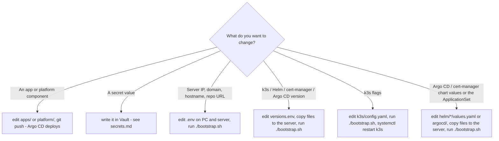

# Operations (day 2)

All commands run as root on the server unless noted. `export KUBECONFIG=/etc/rancher/k3s/k3s.yaml`
(or use `k3s kubectl`).

## Where to change what



The repo is not cloned on the server. "Copy files to the server" means the scp block in
[bootstrap.md](bootstrap.md#copying-the-files-to-the-server).

## Upgrades

| Component | How | Watch out for |
|---|---|---|
| k3s | bump `K3S_VERSION`, re-run `bootstrap.sh` (the installer upgrades in place and restarts k3s) | Kubernetes versions supported by Argo CD and cert-manager. Move one minor version at a time. Short API downtime while it restarts |
| Traefik, CoreDNS, … | come with the k3s version | — |
| cert-manager | bump `CERT_MANAGER_VERSION`, re-run | Read the upgrade notes for each minor. CRDs are upgraded by the chart (`crds.enabled`) |
| Argo CD | bump `ARGO_CD_CHART_VERSION`, re-run | Read the Argo CD upgrade notes for each minor (`docs/operator-manual/upgrading/` in the Argo CD repo) and the chart's changelog for renamed values. CRDs are upgraded by the chart (`crds.install`). Apps keep running during the upgrade |
| Helm CLI | bump `HELM_VERSION`, re-run | — |
| Vault | bump the dependency `version` in `platform/vault/Chart.yaml`, and `vault.server.image.tag` **and** the `unsealer` sidecar image in its `values.yaml` to the same tag (`tools/check.sh` compares the rendered images), push | Read the chart changelog and Vault upgrade notes. Take a [snapshot](secrets.md#backup-and-restore) first. Argo CD replaces `vault-0` (`updateStrategyType: RollingUpdate`) and the sidecar unseals it; short Vault outage |
| External Secrets | bump the dependency `version` in `platform/external-secrets/Chart.yaml` **and** the three image tags (controller, `webhook`, `certController`) in its `values.yaml` to `v<version>` (`tools/check.sh` compares the rendered images), push | Read the release notes for CRD / API version changes (`external-secrets.io/v1` is used) |
| Forgejo | bump the dependency `version` in `apps/forgejo/Chart.yaml`, and `forgejo.image.tag` **and** the `register-runner` image in its `values.yaml` to the same version (`tools/check.sh` compares the rendered images), push. Runner and `dind`: `runner.image` / `runner.dindImage` | Read the Forgejo release notes. Back up the PV first ([forgejo.md](forgejo.md#backup-and-upgrade)): the DB is migrated on start, no downgrade |
| Apps | change the image tag or chart version in `apps/<name>`, push | — |

Before any platform upgrade, take a [backup](#backups).

## Backups

What Git does **not** contain:

| What | Where | How to back it up |
|---|---|---|
| `.env` | your PC | Keep a copy in a password manager |
| Cluster datastore (all objects, Argo CD admin password) | `/var/lib/rancher/k3s/server/db/` (SQLite) | Cold copy, see below |
| Secrets encryption key | `/var/lib/rancher/k3s/server/cred/` | Same tarball. **Without it, the encrypted Secrets in the DB are unreadable** |
| Server token + certs | `/var/lib/rancher/k3s/server/token`, `.../tls/` | Same tarball |
| App data (PVs) | `/var/lib/rancher/k3s/storage/` | `tar`/`restic` it, ideally with the app scaled to 0. Stop the Argo CD application controller first ([pausing GitOps](gitops.md#pausing-gitops)), or self-heal scales the app back up |
| Hand-made Secrets | in the DB | Covered by the DB backup. Also keep the values in your password manager |
| Vault data | PV of `vault-0` (Raft) | `vault operator raft snapshot save`, see [secrets.md](secrets.md#backup-and-restore) |
| Vault unseal key + root token | your password manager (key also in Secret `vault/vault-unseal-keys`) | Needed to restore a snapshot or recreate the Secret |
| Forgejo data | PV `forgejo-data` | `tar` with Forgejo and the Argo CD application controller scaled to 0 (self-heal would restart Forgejo), see [forgejo.md](forgejo.md#backup-and-upgrade) |

Cold datastore backup (about 1 minute of API downtime; running pods keep running):

```bash
systemctl stop k3s
tar -czf /root/k3s-server-$(date +%F).tgz -C /var/lib/rancher/k3s/server db cred tls token
systemctl start k3s
# copy it off the server, e.g. from your PC:  scp root@<server>:/root/k3s-server-*.tgz .
```

The tarball contains secrets. Store it like a password, and **never** in this repo.
(`k3s etcd-snapshot` does not apply here: it only works with embedded etcd, and this server uses SQLite.)

Argo CD itself needs no separate backup: its configuration is in this repo and `.env`, and
everything it deploys comes from Git. Only the admin password would have to be set again.

## Restore / rebuild

**A. Rebuild from Git (keeps nothing that isn't in Git or `.env`; new Argo CD admin password):**

1. New Ubuntu 24.04 server. Update `SERVER_IP` in `.env` if the IP changed. Or wipe an existing server without
   reinstalling the OS: `/usr/local/bin/k3s-uninstall.sh` removes k3s and **everything** in the cluster.
2. Copy the files and run `./bootstrap.sh` ([bootstrap.md](bootstrap.md#copying-the-files-to-the-server)).
3. Vault comes up new and empty. Run `./tools/vault-init.sh` once, restore the latest Vault snapshot, then replace the key in
   `vault-unseal-keys` with the **old** Vault's key (all in [secrets.md](secrets.md#backup-and-restore)).
4. Recreate hand-made Secrets, then restore app PV data into `/var/lib/rancher/k3s/storage/` before the apps start
   (or scale them down while restoring). Skip the old Vault volume (`*_vault_data-vault-0`): Vault is restored from its snapshot in step 3.

**B. Restore the datastore (keeps everything). Test this before you rely on it:**

1. Install the **same** k3s version with the same `k3s/config.yaml` (run `bootstrap.sh` up to the k3s step, or the installer by hand).
2. `systemctl stop k3s`, then extract the tarball into `/var/lib/rancher/k3s/server/`, overwriting `db`, `cred`, `tls` and `token`.
3. `systemctl start k3s`, then restore PV data.

## Changing the server IP or domain

1. Update `SERVER_IP` and/or `BASE_DOMAIN` in `.env` (your PC and the server).
2. `./bootstrap.sh`. This updates the annotations on `argocd/in-cluster` and the Argo CD hostname.
   The ApplicationSet re-renders every app with the new domain, Argo CD re-syncs them, and cert-manager
   issues new certificates.
3. If the node IP itself changed, the k3s API certificate may not include the new IP. Add `tls-san: [<new ip or name>]`
   to the server's `/etc/rancher/k3s/config.yaml`, **not** to the committed file, and restart k3s.

## Re-exporting the cluster

`tools/export-cluster.sh` snapshots a running cluster (versions, k3s config, Helm releases and values,
all non-noise objects, secret *names*), for comparing the live cluster against this repo:

```powershell
scp tools/export-cluster.sh root@<server>:/root/
ssh root@<server> "bash /root/export-cluster.sh"
scp root@<server>:/root/k3s-export.tar.gz .secrets/
```

Values are redacted by default. `INCLUDE_SECRETS=1` includes the real Secret values. Keep the result in `.secrets/` (git-ignored).
Then update `docs/current-cluster.md` with anything that changed.

## Troubleshooting

| Symptom | Check |
|---|---|
| `kubectl` hangs / refused | `systemctl status k3s`, `journalctl -u k3s -e` |
| Node `NotReady` | `journalctl -u k3s -e`, `df -h` (disk pressure), `free -h` |
| Pods `Pending` | `kubectl describe pod`. Usually not enough memory on the 8 GB node, or a PVC isn't bound |
| Argo CD UI down | `kubectl -n argocd get pods`, `kubectl -n argocd logs deploy/argocd-server` |
| Argo CD login fails / forgot password | reset it: `kubectl -n argocd patch secret argocd-secret -p '{"data":{"admin.password":null,"admin.passwordMtime":null}}'`, then `kubectl -n argocd rollout restart deploy/argocd-server` (a new `argocd-initial-admin-secret` is generated) |
| App not deployed | `kubectl -n argocd get applications`, see [gitops.md](gitops.md#checking-status) |
| App `Sync failed` after a rebuild, `Skipping auto-sync: failed previous sync attempt` | it synced before a platform component it needs (e.g. External Secrets CRDs) was ready and used up its retries. **Sync** it in the UI once the platform Applications are healthy (see [gitops.md](gitops.md#how-a-folder-becomes-an-application)) |
| No Applications for `apps/` or `platform/` at all | the cluster Secret is missing or unlabelled: `kubectl -n argocd get secret in-cluster --show-labels`, re-run `./bootstrap.sh` |
| Vault not ready, ExternalSecrets not syncing | Vault is sealed: `kubectl -n vault logs vault-0 -c unsealer`, see [secrets.md](secrets.md#restarts-auto-unseal) |
| Certificate missing | see [tls-and-ingress.md](tls-and-ingress.md#debugging-a-certificate) |
| 404 from Traefik | Ingress host doesn't match the URL, or `ingressClassName` isn't `traefik`: `kubectl get ingress -A` |

## Hardening TODO

Known gaps on the current server, in priority order:

1. **Host firewall**: the provider firewall in front of the VPS restricts inbound traffic by source IP
   (see [architecture.md](architecture.md#network-ports-on-the-host)). `bootstrap.sh` does not enable `ufw`; as a
   second layer in case the provider rules change, suggested:
   ```bash
   ufw default deny incoming && ufw default allow outgoing
   ufw allow 22/tcp && ufw allow 80/tcp && ufw allow 443/tcp
   ufw allow from <your home IP> to any port 6443 proto tcp
   ufw allow from 10.42.0.0/16 && ufw allow from 10.43.0.0/16   # k3s pod / service CIDRs
   ufw enable
   ```
   Keep the SSH session open while enabling, and test from a second one.
2. **SSH**: key-only login (`PasswordAuthentication no`), and consider a non-root user.
3. **Argo CD**: change the initial admin password and delete `argocd-initial-admin-secret` (see [bootstrap.md](bootstrap.md#first-login)).
4. **Vault**: the UI/API at `vault.<BASE_DOMAIN>` is reachable from every IP the provider firewall allows. Revoke the
   root token after setup ([secrets.md](secrets.md#first-time-setup)). Optionally move the unseal key off the node with a
   cloud KMS seal.
5. **Backups**: automate the datastore, PV and Vault snapshot backups to off-site storage.
6. **Forgejo Actions**: the runner's `dind` container is privileged and every job can use its Docker API, so any
   workflow that runs (and every action it uses) can take over the node. Until the runner moves to a separate VM
   without cluster credentials or app data, keep Forgejo registration closed, repository write access and fork
   approvals to people you would give root, and pin actions to commit SHAs ([forgejo.md](forgejo.md#security)).

## Uninstall

`/usr/local/bin/k3s-uninstall.sh` removes k3s and **all** cluster data on the node.
