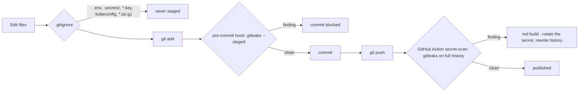

# Secret scanning and the public repo

The repo is public, so three layers keep private data out of it:



| Layer | File | Can be skipped? |
|---|---|---|
| 1 `.gitignore` | `.gitignore` | `git add -f`, but layer 2 catches the file names too |
| 2 pre-commit hook | `.githooks/pre-commit` + `.gitleaks.toml` | `git commit --no-verify` |
| 3 CI scan | `.github/workflows/gitleaks.yml` | no, it runs on every push and PR |

## One-time setup per clone

```bash
winget install Gitleaks.Gitleaks      # Windows (reopen the terminal)   |  brew install gitleaks (macOS)
sh tools/setup-git-hooks.sh           # sets git config core.hooksPath .githooks
```

Without gitleaks installed, the hook **blocks every commit** on purpose.

## Rules (`.gitleaks.toml`)

On top of gitleaks' built-in rules:

| Rule id | Blocks |
|---|---|
| `forbidden-file` | `.env`, `*.pem`, `*.key`, `*_ed25519`, `*kubeconfig*`, `k3s.yaml`, `*.tar.gz`, anything in `.secrets/` |
| `public-ipv4` | Any public IPv4 address. Private, loopback, CGNAT, documentation ranges and the big public DNS resolvers are allowed |
| `ip-hostname` | Hostnames embedding an IP: `*.sslip.io`, `*.nip.io`, `*.xip.io` |
| `k3s-token` | k3s join tokens (`K10…::…`) |
| `kubeconfig-credential` | `client-key-data`, `client-certificate-data`, inline `token:` values |
| `k8s-secret-data` | `kind: Secret` with `data` / `stringData` |
| `password-assignment` | `password=…`, `secret: …`, `token=…` with a real-looking value (placeholders like `change-me…` and `${VAR}` are allowed) |

Allow-listed files: `.gitleaks.toml`, `.env.example`, `versions.env`.

## Writing docs and code that pass

- Write `<SERVER_IP>`, `<BASE_DOMAIN>`, `whoami.<BASE_DOMAIN>`, not real values.
- Don't write example IPs in public ranges. If you need one, use `192.0.2.10` (reserved for documentation).
- In examples, write passwords as `change-me` or `${VAR}`.

## False positives

- Append `# gitleaks:allow` to the line, **or**
- add the `Fingerprint:` printed by gitleaks to `.gitleaksignore`.

## If something leaked

1. **Rotate it first** (new password/token/key). Assume the old value is compromised the moment it's pushed.
2. Remove it from history (`git filter-repo`), then force-push.
3. Public IPs can't be rotated. Consider firewalling the exposed ports instead (see [operations.md](operations.md#hardening-todo)).
