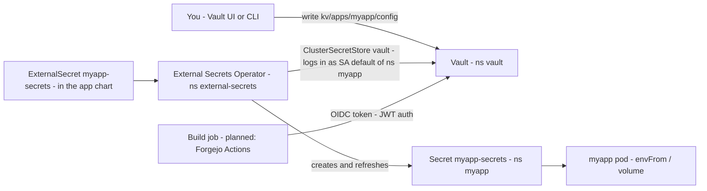
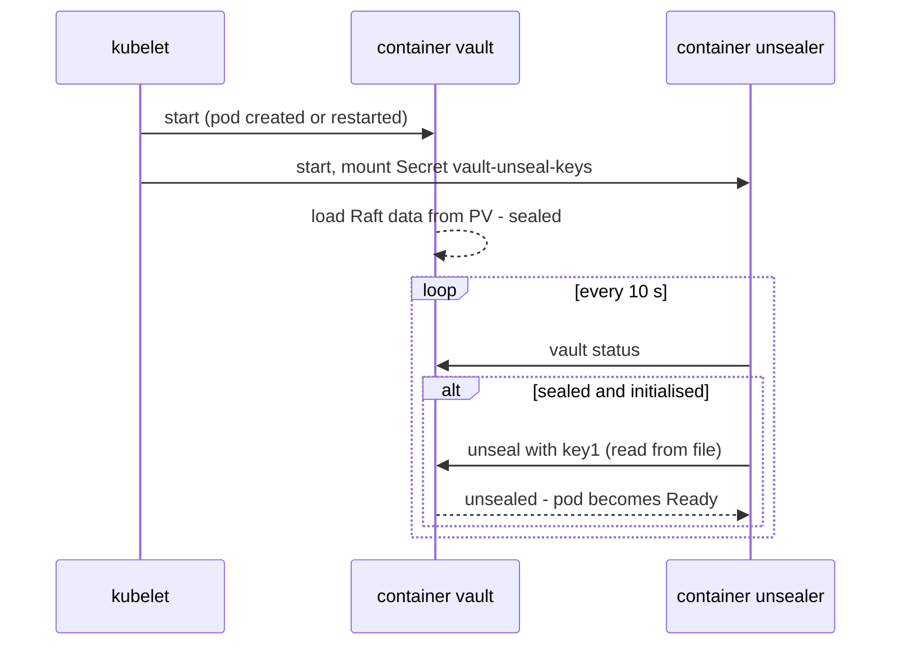
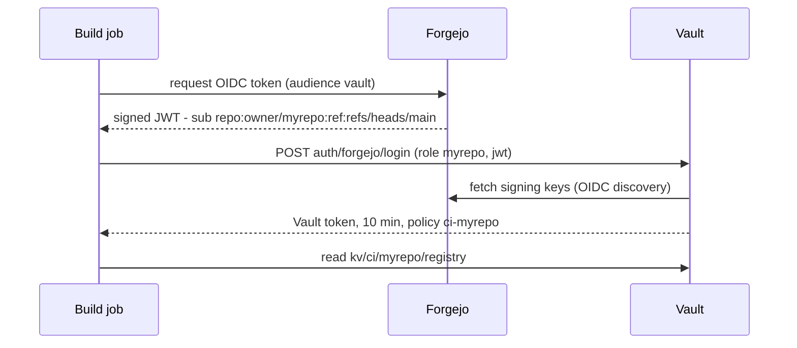

# Secrets: Vault + External Secrets

Secret values never go into this public repo. They live in **HashiCorp Vault** (`platform/vault`).
The **External Secrets Operator** (`platform/external-secrets`) copies them into normal Kubernetes
Secrets that apps mount as usual. Builds (CI) read their secrets from the same Vault.



| Part | Where | What it does |
|---|---|---|
| Vault server | `platform/vault` (wrapper of chart `hashicorp/vault`) | One pod `vault-0`, Raft storage on a 2 Gi local-path PV, UI + API at `https://vault.<BASE_DOMAIN>` |
| External Secrets Operator | `platform/external-secrets` (wrapper of chart `external-secrets`) | Controller, webhook, cert controller, and the `ClusterSecretStore vault` |
| Auto-unseal | sidecar `unsealer` in `vault-0` + Secret `vault/vault-unseal-keys` (made by `tools/vault-init.sh`) | Unseals Vault on every start, so pod restarts need no action |
| Vault setup | `tools/vault-init.sh` (once), `tools/vault-configure.sh` (both source `tools/vault-lib.sh`) | Init + unseal key Secret; KV engine, Kubernetes auth, per-namespace policy and role for the store |
| Unseal key + root token | your password manager (key also in the Secret above) | Never in this repo, `.env` or `.secrets/` |

Commands on this page run in bash **on the server as root** (`export KUBECONFIG=/etc/rancher/k3s/k3s.yaml`),
unless a block says otherwise.

## Where secrets live in Vault

All secrets are in the KV v2 engine mounted at `kv/`:

| Path | For | Who can read it |
|---|---|---|
| `kv/apps/<namespace>/<name>` | app secrets, e.g. `kv/apps/myapp/config` (app namespace = folder name) | `ExternalSecret`s in that namespace only (policy `external-secrets`, see [isolation](#namespace-isolation)) |
| `kv/ci/<repo>/<name>` | build secrets, e.g. registry credentials | the build jobs of that repo (see [Builds](#builds-forgejo-actions)) |

## First-time setup

Once per new cluster. After the first sync, `platform-vault` shows `Progressing` and `vault-0` is `Running`
but not ready: a new Vault is **uninitialised and sealed**. On the server (root):

```bash
cd /root/homelab && ./tools/vault-init.sh
```

The script:

1. runs `vault operator init` with **one** unseal key and prints the unseal key and root token straight away.
   Inside the pod, init first writes its output to `/home/vault/vault-init.json` (mode 0600, in the pod's `emptyDir`)
   and the script reads it from there, so a dropped `kubectl exec` connection can't lose the key and token. The file
   is deleted once both are printed. If the script stops before that, it prints the commands to read and delete
   the file (a re-run prints them too),
2. stores the key in Secret `vault/vault-unseal-keys` (created by the script, not from Git). A Secret left over from
   an earlier Vault (e.g. after the PV was wiped) is replaced: its key can't open the new Vault,
3. runs `tools/vault-configure.sh` with the root token (KV engine, Kubernetes auth, External Secrets policy and role).
   It first waits up to 5 minutes for the pod to answer, the unsealer sidecar to unseal Vault, and Vault to become
   active (`HA Mode active` in `vault status`, a few seconds after unsealing), so it is also safe to run right after
   `kubectl -n vault delete pod vault-0`.

It prints the unseal key and the root token **once**. Put both in your password manager right away.
Apart from that, the unseal key exists only in Secret `vault-unseal-keys` (k3s datastore on the server's disk, see
the [trade-off](#restarts-auto-unseal)); the root token is not stored anywhere. If a later step fails, the script
tells you what to run; the values are already on screen. Then check:

```bash
kubectl get clustersecretstore vault          # READY True (the operator retries; give it a minute)
```

The store logs in to Vault separately for each namespace (see [isolation](#namespace-isolation)), so it can't test
the login on its own. Whether a login works shows on the first `ExternalSecret` (step 4 of
[Giving an app a secret](#giving-an-app-a-secret)).

Open `https://vault.<BASE_DOMAIN>` and sign in with the root token. Use the root token only for setup:
create a personal login (e.g. `userpass` with an admin policy), then revoke the root token
(`vault token revoke <token>`). You can generate a new one later with `vault operator generate-root` and the unseal key.

## Restarts: auto-unseal

Vault always starts **sealed**. A sidecar container `unsealer` in the `vault-0` pod checks every 10 seconds
and unseals Vault with the key from Secret `vault-unseal-keys`. It passes the key as a file
(`vault write sys/unseal key=@/vault/unseal/key1`), so the key never shows up in a process list.
So a reboot, k3s upgrade, Vault upgrade or rescheduled pod needs **no action**. It is unsealed again a few
seconds after start. The StatefulSet uses `updateStrategyType: RollingUpdate` (the chart's default is `OnDelete`),
so a pushed change to the Vault image or the unsealer replaces `vault-0` on its own.



```bash
kubectl -n vault logs vault-0 -c unsealer      # "unsealer: Vault unsealed"
kubectl -n vault exec vault-0 -c vault -- vault status    # "Sealed  false"
```

To recreate or replace the Secret from your password manager (it was lost, or Vault data was restored from another
cluster), then `kubectl -n vault delete pod vault-0` so the pod mounts it straight away. On the server (root):

```bash
kubectl -n vault delete secret vault-unseal-keys --ignore-not-found
read -rsp "Unseal key: " K; echo
printf '%s' "$K" | kubectl -n vault create secret generic vault-unseal-keys --from-file=key1=/dev/stdin; unset K
```

**Trade-off:** the unseal key sits on the node, protected like every other Kubernetes Secret (encrypted at rest
by k3s, but the encryption key is on the same disk). Someone with root on the server or a copy of its disk can
unseal Vault. On a single node that is roughly the trust boundary anyway. A cloud KMS seal (`seal "awskms"`)
would keep the key off the node and make access revocable. Switching to it later is a seal migration.

## Giving an app a secret

1. **Write the secret to Vault** under `apps/<the app's namespace>/`. Easiest in the UI: `kv` → **Create secret** → path `apps/myapp/config`,
   then add keys such as `API_KEY`. Or use the CLI in the pod, from the server (root). `=-` reads the value
   from stdin, so it stays out of history:
   ```bash
   kubectl -n vault exec -it vault-0 -- sh
   vault login                                   # paste your token
   vault kv put kv/apps/myapp/config API_KEY=-   # paste the value, then Ctrl-D
   rm ~/.vault-token && exit
   ```
2. **Add an ExternalSecret to the app chart**, e.g. `apps/myapp/templates/externalsecret.yaml`:
   ```yaml
   apiVersion: external-secrets.io/v1
   kind: ExternalSecret
   metadata:
     name: myapp-secrets
   spec:
     refreshInterval: 1h            # how often Vault is re-read
     secretStoreRef:
       kind: ClusterSecretStore
       name: vault
     target:
       name: myapp-secrets          # the Kubernetes Secret the operator creates
     dataFrom:
       - extract:
           key: apps/myapp/config   # every key of this Vault secret becomes a key of the Secret
   ```
   To pick single keys instead, use `data:` with `remoteRef: { key: apps/myapp/config, property: API_KEY }`.
   `key` is the path **without** `kv/` (the store adds it) and must start with `apps/<this namespace>/`.
3. **Use the Secret** in the Deployment as usual, e.g. `envFrom: [{ secretRef: { name: myapp-secrets } }]`.
4. Push, then check:
   ```bash
   kubectl -n myapp get externalsecret      # STATUS SecretSynced, READY True
   ```

Pods don't restart when a Secret changes. Run `kubectl -n myapp rollout restart deploy/myapp` after
changing a value (no reloader is installed).

## Builds (Forgejo Actions)

**Planned, not configured yet.** It gets set up together with Forgejo and its runners. The idea: a job asks Forgejo
for a short-lived OIDC token and logs in to Vault with it. Vault only lets that repo (and branch) read
`kv/ci/<repo>/*`. No long-lived secret is stored in Forgejo.



Vault side (to be added to `tools/vault-configure.sh` once Forgejo runs at `https://git.<BASE_DOMAIN>`):

```bash
vault auth enable -path=forgejo jwt
vault write auth/forgejo/config \
  oidc_discovery_url="https://git.<BASE_DOMAIN>/api/actions" \
  bound_issuer="https://git.<BASE_DOMAIN>/api/actions"
P=ci-myrepo
vault policy write "$P" - <<'EOF'
path "kv/data/ci/myrepo/*" { capabilities = ["read"] }
EOF
vault write auth/forgejo/role/myrepo role_type=jwt user_claim=sub \
  bound_audiences=vault \
  bound_subject="repo:owner/myrepo:ref:refs/heads/main" \
  token_policies="$P" token_ttl=10m
```

Workflow side (`.forgejo/workflows/build.yaml`, sketch):

```yaml
on: push
enable-openid-connect: true      # job gets ACTIONS_ID_TOKEN_REQUEST_URL / _TOKEN
jobs:
  build:
    runs-on: docker
    steps:
      - name: Read secrets from Vault
        run: |
          JWT=$(curl -sf -H "Authorization: bearer ${ACTIONS_ID_TOKEN_REQUEST_TOKEN}" \
                "${ACTIONS_ID_TOKEN_REQUEST_URL}&audience=vault" | jq -r .value)
          VT=$(curl -sf -d "{\"role\":\"myrepo\",\"jwt\":\"$JWT\"}" \
               https://vault.<BASE_DOMAIN>/v1/auth/forgejo/login | jq -r .auth.client_token)
          curl -sf -H "X-Vault-Token: $VT" https://vault.<BASE_DOMAIN>/v1/kv/data/ci/myrepo/registry \
            | jq -r .data.data.password > "$RUNNER_TEMP/registry-password"
```

To verify when setting this up:

- `enable-openid-connect` is documented for Forgejo Actions (issuer `<forgejo URL>/api/actions`, `sub` =
  `repo:<repository>:ref:<ref>`), but check that your Forgejo release has it.
- Since Forgejo 16, `<repository>` in the token can be `owner-ID/repo-ID` instead of `owner/repo`.
  Decode a real token once and use exactly its `sub` in `bound_subject`.
- Jobs can reach Vault through the public URL. If runner containers can resolve cluster DNS,
  `http://vault-active.vault.svc.cluster.local:8200` also works.

## Security notes

### Namespace isolation

There is one `ClusterSecretStore vault` for the whole cluster, but an `ExternalSecret` can only read the secrets of
its own namespace:

1. The store's `serviceAccountRef` has no namespace. The operator therefore requests a token (audience `vault`) for
   ServiceAccount `default` **in the namespace of the `ExternalSecret`** and logs in to Vault with it.
2. Vault role `external-secrets` accepts ServiceAccount `default` from any namespace.
3. Policy `external-secrets` is templated on the namespace of the login:
   `kv/data/apps/{{identity.entity.aliases.<kubernetes accessor>.metadata.service_account_namespace}}/*`.
   `tools/vault-configure.sh` fills in the accessor of the `kubernetes/` auth mount.

So an `ExternalSecret` in namespace `myapp` gets `kv/apps/myapp/*` and `permission denied` for `kv/apps/otherapp/*`.
Anyone who can create objects in namespace `myapp` can read that namespace's secrets, as with any Kubernetes Secret
there.

### Other notes

- **Vault is on the internet** at `https://vault.<BASE_DOMAIN>` (TLS from Let's Encrypt), reachable only from the IPs
  that the provider firewall in front of the VPS allows (see [architecture.md](architecture.md#network-ports-on-the-host)).
  Anyone who can connect from an allowed IP can attempt logins, so revoke the root token after setup and protect your tokens.
- Copies in Kubernetes Secrets are encrypted at rest by k3s (`secrets-encryption`). The same goes for the
  unseal key in `vault-unseal-keys`, see the [trade-off](#restarts-auto-unseal).
- gitleaks' built-in rules flag Vault tokens (`hvs.…`), but they can't recognise unseal keys. Never paste those anywhere.

## Backup and restore

Vault data is a Raft database on the PV. Take a snapshot (server, root; needs a token):

```bash
kubectl -n vault exec -it vault-0 -c vault -- sh -c 'vault login && vault operator raft snapshot save /tmp/vault.snap; rm -f ~/.vault-token'
kubectl -n vault cp -c vault vault-0:/tmp/vault.snap /root/vault-$(date +%F).snap
kubectl -n vault exec vault-0 -c vault -- rm /tmp/vault.snap
```

The snapshot is encrypted. **Restoring it needs the unseal key from the same Vault**, so keep both.

Restore (server, root). Vault must be initialised and unsealed; on a rebuilt cluster run `./tools/vault-init.sh` first.
`vault login` asks for the root token of the Vault you restore **into** (on a rebuilt cluster, the one `vault-init.sh` printed).
Replace `<DATE>` with the snapshot's date:

```bash
kubectl -n vault cp -c vault /root/vault-<DATE>.snap vault-0:/tmp/vault.snap
kubectl -n vault exec -it vault-0 -c vault -- sh -c 'vault login && vault operator raft snapshot restore -force /tmp/vault.snap; rm -f ~/.vault-token /tmp/vault.snap'
```

From then on Vault has the old Vault's data, tokens and unseal key: put the **old** key into `vault-unseal-keys`
(see [Restarts](#restarts-auto-unseal)) and use the old root token.

## Troubleshooting

| Symptom | Check |
|---|---|
| `vault-0` not ready | sealed or not initialised: `kubectl -n vault logs vault-0 -c unsealer`. "has no keys" → Secret `vault-unseal-keys` missing; "rejected" → wrong key; not initialised → run `tools/vault-init.sh` |
| `ClusterSecretStore vault` not ready | `kubectl describe clustersecretstore vault`. Usually the operator is not running yet: `kubectl -n external-secrets get pods` |
| Vault upgrade | change `server.image.tag` **and** the `unsealer` image in `platform/vault/values.yaml` together (`sh tools/check.sh` fails if they differ). After the push Argo CD replaces `vault-0` and the sidecar unseals it |
| `vault-configure.sh`: "still sealed" | The unsealer did not unseal Vault within 5 min: `kubectl -n vault logs vault-0 -c unsealer` (see `vault-0` not ready above). After creating the Secret, run `kubectl -n vault delete pod vault-0` and then re-run `./tools/vault-configure.sh` |
| `vault-configure.sh`: "unsealed but not active" | Vault did not become leader within 5 min: `kubectl -n vault logs vault-0 -c vault` |
| App sync failed: `no matches for kind "ExternalSecret"` or webhook `externalsecret-validate` refused | the app synced before `platform-external-secrets` was ready (new cluster). It retries for about 20 minutes ([gitops.md](gitops.md#how-a-folder-becomes-an-application)); once `kubectl -n external-secrets get pods` are all ready, a still failed app needs **Sync** in the UI or a new push |
| ExternalSecret `SecretSyncedError` | `kubectl -n myapp describe externalsecret myapp-secrets`. `key` must be `apps/myapp/...`: without the `kv/` mount (the store adds it), and the second part must be the ExternalSecret's own namespace. Also: Vault sealed, or `tools/vault-configure.sh` not run |
| `permission denied` in operator logs | `kubectl -n external-secrets logs deploy/external-secrets`. Path of another namespace (see [isolation](#namespace-isolation)), or role/audience/ServiceAccount differ between `platform/external-secrets/values.yaml` and `tools/vault-configure.sh` |
| Vault UI shows "sealed" or the init page | the Ingress reaches `vault-0` also while it is sealed or uninitialised: see `vault-0` not ready above |
| Vault UI 404 / no certificate | see [tls-and-ingress.md](tls-and-ingress.md#debugging-a-certificate) (Ingress `vault`, Secret `vault-tls`) |
