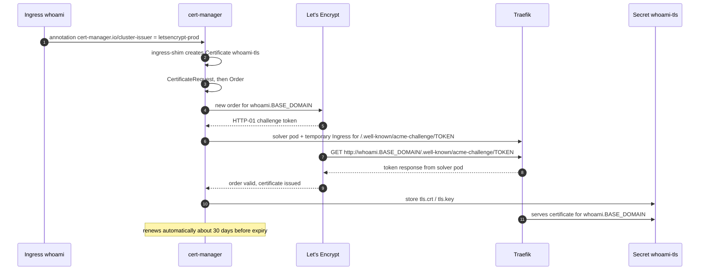

# TLS and ingress

## Certificates

Every certificate comes from the ClusterIssuers in `platform/cluster-issuer`, requested through the
`cert-manager.io/cluster-issuer` annotation on an Ingress:

| Who | Issuer | Ingress / namespace | Certificate / Secret |
|---|---|---|---|
| Argo CD UI | `letsencrypt-prod` (annotation set in `helm/argo-cd/values.yaml`) | `argocd-server`, `argocd` | `argocd-server-tls` |
| Vault UI / API | `letsencrypt-prod` | `vault`, `vault` (`platform/vault/templates/ingress.yaml`) | `vault-tls` |
| Your apps | `letsencrypt-prod` / `letsencrypt-staging` | the app's Ingress | one `<app>-tls` per Ingress |

All use ACME **HTTP-01** challenges solved through Traefik, so port 80 must be reachable from the internet.

On a fresh server the Argo CD Ingress exists before Argo CD has deployed the ClusterIssuers, so its
Certificate waits for a minute or two until `letsencrypt-prod` is Ready; cert-manager then issues
it without any action. Until then the browser shows Traefik's default certificate.

## Issuance flow for an app



## Staging vs production

- `letsencrypt-staging`: untrusted certificates (browser warning) with very high rate limits. Use it while you iterate on a new app.
- `letsencrypt-prod`: trusted certificates, strict rate limits (duplicate certs and failed validations are limited per week). Switch to it once the app works.
- Switching: change the annotation and push. Then delete the old secret once, so cert-manager reissues:
  `kubectl -n <ns> delete secret <app>-tls`.

## Debugging a certificate

```bash
kubectl get certificate,certificaterequest,order,challenge -A
kubectl -n whoami describe certificate whoami-tls
kubectl -n whoami describe challenge          # shows why HTTP-01 fails
kubectl -n cert-manager logs deploy/cert-manager
kubectl -n argocd describe certificate argocd-server-tls   # the Argo CD UI certificate
```

Common causes:

| Symptom | Cause |
|---|---|
| Challenge `pending`, "connection refused/timeout" | Port 80 blocked (firewall / VPS provider), or DNS doesn't point at the server |
| `429 rateLimited` | Too many prod requests. Wait, and use staging meanwhile |
| Browser shows "TRAEFIK DEFAULT CERT" | Certificate not issued yet, or `tls.secretName` / `hosts` mismatch |

## Traefik

Bundled with k3s (`kube-system/traefik`, HelmChart in `/var/lib/rancher/k3s/server/manifests/traefik.yaml`).
Not customized here. To change its settings (e.g. force HTTP→HTTPS redirect), add a `HelmChartConfig`:

```yaml
apiVersion: helm.cattle.io/v1
kind: HelmChartConfig
metadata:
  name: traefik
  namespace: kube-system
spec:
  valuesContent: |-
    ports:
      web:
        redirections:
          entryPoint:
            to: websecure
            scheme: https
```

It could live in `platform/traefik/` (a small Helm chart like the other platform folders, with the manifest in `templates/`; Argo CD picks it up). Check the values against the bundled Traefik chart version first.
A global redirect can interfere with HTTP-01 challenges. Test it with staging.

Without it, Traefik serves every Ingress on port 80 as well as 443. To redirect a single Ingress, add a Traefik
`Middleware` to its chart and reference it from the Ingress (as the Grafana and Vault Ingresses in `platform/monitoring` and
`platform/vault` do). cert-manager's HTTP-01 solver Ingress has its own, more specific router, so challenges keep working:

```yaml
apiVersion: traefik.io/v1alpha1
kind: Middleware
metadata:
  name: redirect-https
spec:
  redirectScheme:
    scheme: https
    permanent: true
---
# on the Ingress: NAMESPACE-MIDDLEWARE@kubernetescrd
metadata:
  annotations:
    traefik.ingress.kubernetes.io/router.middlewares: {{ printf "%s-redirect-https@kubernetescrd" .Release.Namespace }}
```
